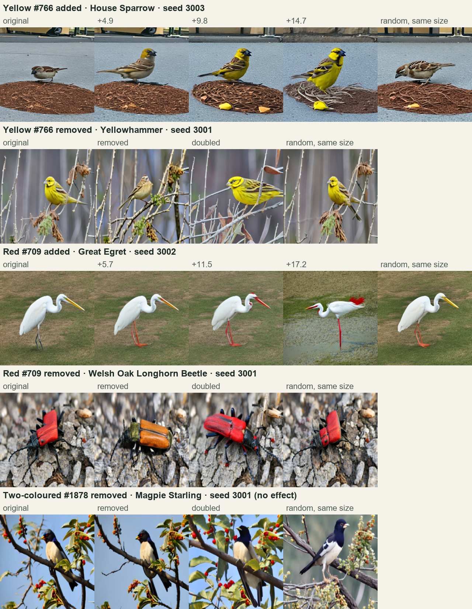
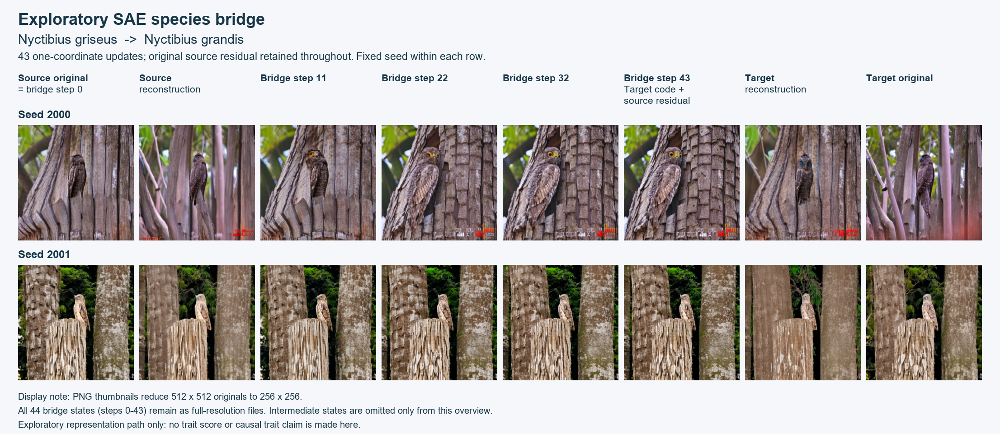

# BioCLIP trait discovery

This project asks whether a model that reads a species' taxonomy learns anything about its appearance. BioCLIP 2 encodes the taxonomy text, a sparse autoencoder learns a dictionary of directions in that embedding, and TaxaAdapter generates images from the original or edited vector. Only the sparse autoencoder is trained in this pipeline.

## Current progress

| Workstream | Status | Evidence and open questions |
|---|---|---|
| Embeddings and SAE training | Complete | Encoded 362,460 corrected taxonomy records. Across five retrains, 732 of 2,048 anchor features passed both recurrence criteria. [Expanded study](task5_bioclip_sae/generation/experiments/expanded_followup_2026_10_04/REPORT.md) |
| Species comparisons | Complete | Computed ten neighbours per species and rendered ladybird, potoo and owl bridges. Visible changes varied by image seed. [Experiment index](task5_bioclip_sae/generation/experiments/README.md) |
| Colour interventions | Exploratory results available | Seven appearance candidates were tested. Orange, red and yellow showed the clearest shifts in the reviewed images. Some edits also changed the background or the animal's shape. [Full galleries](task5_bioclip_sae/generation/experiments/feature_gallery_v2/REPORT.md) |
| Independent colour scoring | Awaiting scores | The blinded scoring page is prepared. Independent confirmation of the colour observations remains open. [Review procedure](task5_bioclip_sae/generation/experiments/blind_colour_review_v1/README.md) |
| Measured bird traits | Validation complete | The beak probe did not outperform taxonomy. The selected beak and tail features failed validation. The tail study stopped before test scoring or image generation. [Beak benchmark](task5_bioclip_sae/generation/experiments/trait_benchmark_v1/REPORT.md) · [Tail follow-up](task5_bioclip_sae/generation/experiments/trait_followup_2026_10_07/REPORT.md) |
| Ladybird spot counts | Baseline reviewed | One human reviewer could score 27 of 32 unedited images. Only three showed exactly seven visible spots. View eligibility remains a measurement issue. [Human review](task5_bioclip_sae/generation/experiments/human_review_2026_10_07/REPORT.md) |

## Start here

Read the [illustrated experiments and technical walkthrough](TECHNICAL_GUIDE.md) for the equations, tensor shapes, training loop and image-edit calculation. Then follow one result from each stage using the files below. All four activities use saved outputs and can be completed directly on GitHub.

| Question | Open first | What to look for |
|---|---|---|
| What does a species vector capture? | [20-bird embedding pilot](task4_bioclip_pilot/README.md) | Trace the Chipping Sparrow from taxonomy text to its three nearest neighbours. |
| How do 768 numbers become interpretable candidates? | [SAE training and evaluation](task5_bioclip_sae/README.md) | Follow one batch through the encoder and check how much error remains on unseen genera. |
| What changes when one feature is edited? | [Generation walkthrough](task5_bioclip_sae/generation/README.md) | Compare the same sparrow and image seed across yellow-feature strengths and a random edit. |
| Does a feature predict a real measurement? | [Experiment index](task5_bioclip_sae/generation/experiments/README.md) | Compare a candidate with a taxonomy baseline and follow the decision to stop at validation. |

### Key findings

1. **Input format and data size matter.** TaxaAdapter writes taxonomy with spaces, not commas; switching changed the nearest neighbour for 53% of species, so all later work uses the generator's format. With 5,388 species no SAE feature survived retraining; with 362,460 species, 732 of 2,048 do.
2. **Most stable features detect groups, not traits.** For 76% of the 732 stable features, all 8 top species belong to one family (63% to one genus), computed from the anchor SAE's `features.json`.
3. **Three candidate directions influenced generated colour in the unblinded gallery.** Turning up orange #938, red #709 or yellow #766 recolours unrelated animals with a dose response; turning them down removes the colour (garibaldi, Yellowhammer and a red longhorn beetle, 4/4 image seeds each); random edits of the same size do neither. These features also fire for animals of that colour whose names never mention it, while the four failing features track spelling or a single Latin word. Judgments so far are unblinded.

   

4. **The tested beak and tail predictors did not improve on taxonomy.** Against AVONET bird measurements, the raw vectors predict beak shape (test R² 0.66) no better than a family/order average (0.68), and the best SAE candidates for beak shape and tail/wing ratio failed validation on held-out genera.
5. **Spot count is a poor test trait.** Unedited seven-spot ladybirds are drawn with 1 to 10 spots; only 3 of 27 countable images show exactly seven.
6. **Bridges are uneven.** One-coordinate paths are easy to compute and render, but visible change depends on the image seed. The ladybird turns black with yellow spots midway, the potoo passes through an owl-like bird, and the two owls barely differ.

   

## Detailed results and history

Start with the [generation README](task5_bioclip_sae/generation/README.md) for links to every experiment. Earlier results: the [follow-up report](task5_bioclip_sae/generation/experiments/trait_followup_2026_10_07/REPORT.md). The [completed human review](task5_bioclip_sae/generation/experiments/human_review_2026_10_07/REPORT.md) found **27/32 unedited ladybird images scorable, exactly seven visible spots in 3/27, and five images remaining NA**. These are one human reviewer's visible counts; substantial disagreement with the earlier provisional AI pass about view eligibility remains unresolved.

The new AVONET endpoint is the natural log of species-mean tail length divided by species-mean wing length. Training selected feature **814** from the existing 732 recurrent features. It failed validation: family-centered correlation changed from **-0.1467** in training to **+0.0803** in validation, and adding its activation did not improve prediction over taxonomy. The prespecified stop rule was followed: test endpoint values were not computed and no tail-image branch was launched. The follow-up reused the existing SAE without retraining.

The [expanded study](task5_bioclip_sae/generation/experiments/expanded_followup_2026_10_04/REPORT.md) retains **362,460 corrected TreeOfLife-10M taxonomy records, raw 768-dimensional space-formatted embeddings, 732/2,048 features recurring across all five new seeds**, and the **98-image exploratory ladybird bridge**. Its raw-embedding beak-shape probe and training-selected SAE candidate failed validation. Biological trait control remains unvalidated, and the exact TreeOfLife-1M training manifest remains unavailable.

The earlier [5,388-species stability study](task5_bioclip_sae/generation/experiments/followup_2026_10_04/REPORT.md), [188-image report](task5_bioclip_sae/generation/experiments/existing_sae_v1/REPORT.md) and [saved-image viewer](task5_bioclip_sae/generation/experiments/existing_sae_v1/viewer.html) remain historical results. Human review of the older 28-image set remains deferred. The preliminary expanded v1 corpus was superseded after source-quality checks; use corrected v2 artifacts for current work.

| Experiment | Completed work | Read the results |
| --- | --- | --- |
| trait follow-up | Training-selected tail/wing candidate 814 failed validation; test endpoint not computed; no image branch or SAE retraining | [Current report](task5_bioclip_sae/generation/experiments/trait_followup_2026_10_07/REPORT.md) |
| human review | 27/32 ladybird images scorable; 3/27 exact-seven; five NA; single reviewer with unresolved human–AI eligibility disagreement | [Human results](task5_bioclip_sae/generation/experiments/human_review_2026_10_07/REPORT.md) |
| expanded study | Corrected 362,460-record corpus; 732 recurrent features across five new SAE seeds; negative beak-shape tests; 98-image exploratory bridge | [Expanded report](task5_bioclip_sae/generation/experiments/expanded_followup_2026_10_04/REPORT.md) |
| Task 4 | 20 bird species, 768-dimensional embeddings, cosine neighbors, attributed reference photos | [Task 4 report](task4_bioclip_pilot/results/RESULTS.md) |
| Task 5: original embedding pilot | 5,388 animal species, comma-separated taxonomy, a 2,048-feature TopK SAE with 32 active features, evaluation on held-out genera, five candidate-feature photo panels | [Original Task 5 report](task5_bioclip_sae/results/RESULTS.md) |
| Task 5: TaxaAdapter generation | Space-separated embeddings for the same 5,388 species, a separately trained SAE, and eight images of *Asio otus* with feature 1969 removed or doubled | [Generation report](task5_bioclip_sae/generation/README.md) |
| Task 5: frozen-SAE continuation | 53,880 overlap-ranked pairs; 84 intervention images across three species/four seeds; 104 images for a 49-coordinate owl bridge across two seeds | [Continuation report](task5_bioclip_sae/generation/experiments/existing_sae_v1/REPORT.md) |
| Task 5: historical 5,388-species aligned stability | Five new SAE seeds plus exact original-seed reproduction; zero features pass combined recurrence; 28-image scoring-readiness audit with later correction | [Earlier stability report](task5_bioclip_sae/generation/experiments/followup_2026_10_04/REPORT.md) |

The original Task 5 pilot explains 56.31% of held-out test variation relative to the training-mean baseline, with mean reconstruction cosine 0.8874. The five visual associations are hypotheses. The dataset is the public TreeOfLife-10M iNat21 animal subset, not a confirmed exact TreeOfLife-1M training list.

The released TaxaAdapter code and TreeOfLife-1M weights were used for a [first image-generation intervention pilot](task5_bioclip_sae/generation/README.md). That experiment re-extracts and fits an SAE to space-separated taxonomy strings to match the released generator, and compares original/reconstructed/edited inputs across two seeds. Generation works; independent causal trait controls remain unestablished.

## How the code works

1. [Task 4 extraction](task4_bioclip_pilot/run_embeddings.py) encodes full taxonomy text into a raw 768-dimensional vector. Unit-length copies are used for cosine neighbors; reference photos illustrate the results and are not model inputs.
2. [Task 5 extraction](task5_bioclip_sae/prepare_embeddings.py) selects 5,388 Animalia from the included iNat21 naming metadata, sorts species, and assigns whole genera to training, validation, or test. The saved split contains 4,254 / 541 / 593 species.
3. [SAE training](task5_bioclip_sae/train_sae.py) subtracts the training mean, scales by the training RMS, maps 768 inputs to 2,048 activations, keeps the largest 32 positive activations, and decodes back to the original embedding scale. Validation error selects the checkpoint; training-only PCA provides reconstruction baselines.
4. [Format alignment](task5_bioclip_sae/generation/prepare_alignment.py) rebuilds taxonomy strings using spaces and trains a separate SAE. Comma-versus-space embeddings have mean cosine 0.8257, so the original SAE is not used for the released-format generation experiment.
5. [Generation](task5_bioclip_sae/generation/run_interventions.py) injects the raw or reconstructed vector into the official TaxaAdapter projection. For each fixed seed, it compares the original vector, SAE reconstruction, one feature set to zero, and that feature doubled while holding all other SAE activations fixed.
6. [Overlap retrieval](task5_bioclip_sae/generation/analyze_overlap.py) ranks every recorded species by binary SAE-support overlap. [Frozen experiments](task5_bioclip_sae/generation/run_frozen_experiments.py) preserve reconstruction residuals for feature edits, add active-feature/random-direction controls, and generate a species bridge with exactly one coordinate changed per step. These scripts use existing weights and never call preparation or training.
7. The [expanded protocol and results](task5_bioclip_sae/generation/experiments/expanded_followup_2026_10_04/REPORT.md) use a separately prepared, corrected corpus, frozen raw-vector extraction and the [expanded SAE study runner](task5_bioclip_sae/generation/run_expanded_sae_study.py). The earlier 5,388-species scripts below reproduce their historical pilots; they are not the expanded-data entry point. The [trait follow-up](task5_bioclip_sae/generation/experiments/trait_followup_2026_10_07/REPORT.md) reuses the expanded SAE and whole-genus assignments for one new prospectively specified endpoint.

Feature selection in the generation pilot uses family association among top training examples. Feature 1969 is an owl-family-associated candidate in the aligned model; it does not inherit the labels or indices of the original SAE.

## Historical pilot reconstruction results

| SAE run | Test variation explained | Mean test reconstruction cosine | Saved evidence |
| --- | ---: | ---: | --- |
| Original comma-separated taxonomy | 56.31% | 0.8874 | [Evaluation](task5_bioclip_sae/results/evaluation.json) |
| Generator-aligned space-separated taxonomy | 54.14% | 0.8712 | [Evaluation](task5_bioclip_sae/generation/aligned_evaluation.json) |

Variation explained uses the training-mean baseline. These are reconstruction measurements for different input representations, not trait-discovery scores. Held-out genera refer to the SAE split, not absence from BioCLIP or TaxaAdapter pretraining.

The eight-image pilot uses the Long-eared Owl, seeds 42 and 43, 50 DDIM steps, guidance 6, adapter scale 1 and 512 x 512 images. Feature edits affect appearance, pose and framing; the unedited reconstruction also changes images. [Verification records](task5_bioclip_sae/generation/results/verification.json) cover dimensions, metrics, split separation, checkpoint loading, vector injection and artifact hashes. They do not establish control over an independent biological trait.

## Repository contents

- `task4_bioclip_pilot/`: extraction scripts, pinned model revision, taxonomy inputs, small embedding arrays, rankings, photos and reports.
- `task5_bioclip_sae/`: extraction/training/verification scripts, pinned dataset metadata, species splits, metrics, photo panels and reports.
- `task5_bioclip_sae/generation/`: pinned asset downloaders, format alignment, generation runner, verification, images and provenance for the TreeOfLife-1M checkpoint.
- [Third-party sources and attribution](THIRD_PARTY.md).

Virtual environments and model-download caches are excluded from Git. The original pilot's large NumPy arrays, SAE checkpoint and full `features.json` are also excluded. They are present in the prepared local copy but will **not** be present in a fresh clone; the commands below reproduce those historical runs. Original Task 5 arrays and weights live under `task5_bioclip_sae/data/` and `results/`, and aligned pilot artifacts under `generation/cache/aligned/`. Current corrected vectors live under `generation/cache/expanded_tol10m_v2/`; expanded SAE checkpoints and compressed codes live under `generation/experiments/expanded_stability_w2048_k32_v2/`. Use the expanded report's artifact index and protocols for that run. BioCLIP 2 alone requires approximately 1.71 GB of weights; generation also downloads the adapter, SD 1.5 and VAE components.

## Set up an independent environment

The recorded experiments used Windows, Python 3.12, and an NVIDIA RTX 5090. Task 4 extraction has a CPU fallback; Task 5 extraction/training and the generation runner require CUDA. Original photo-panel scripts use Windows Arial. Hardware requirements beyond this tested machine have not been benchmarked.

The following environment reproduces Task 4 and the original Task 5 pilot. For generation, use the [separate inference setup](task5_bioclip_sae/generation/README.md#reproduce-the-initial-pilot-includes-sae-training), which pins an older Hugging Face Hub version required by its Transformers stack. Do not combine the two requirements files in one installation command.

Run from the repository root in PowerShell:

```powershell
py -3.12 -m venv .venv
& ./.venv/Scripts/python.exe -m pip install --upgrade pip
& ./.venv/Scripts/python.exe -m pip install torch==2.11.0 torchvision==0.26.0 --index-url https://download.pytorch.org/whl/cu130
& ./.venv/Scripts/python.exe -m pip install -r requirements.txt
& ./.venv/Scripts/python.exe task4_bioclip_pilot/download_model.py
```

The CUDA 13.0 wheels match the recorded environment and require a compatible NVIDIA driver. [The original full dependency snapshot](task4_bioclip_pilot/requirements-lock.txt) records transitive versions; the root requirements pin direct dependencies. This packaging step did not validate a fresh dependency installation.

## Reproduce Task 4

Taxonomy, reference photos, and manual observations are included. With the model downloaded:

```powershell
& ./.venv/Scripts/python.exe task4_bioclip_pilot/run_embeddings.py
& ./.venv/Scripts/python.exe task4_bioclip_pilot/make_contact_sheet.py
& ./.venv/Scripts/python.exe task4_bioclip_pilot/write_results.py
```

For optional input refresh, see [Task 4 instructions](task4_bioclip_pilot/README.md). Re-review the manual observations if replacing photos.

## Reproduce Task 5

```powershell
& ./.venv/Scripts/python.exe task5_bioclip_sae/prepare_embeddings.py
& ./.venv/Scripts/python.exe task5_bioclip_sae/train_sae.py
& ./.venv/Scripts/python.exe task5_bioclip_sae/inspect_features.py
& ./.venv/Scripts/python.exe task5_bioclip_sae/make_feature_sheets.py
& ./.venv/Scripts/python.exe task5_bioclip_sae/verify_results.py
& ./.venv/Scripts/python.exe task5_bioclip_sae/write_report.py
```

The feature-inspection step queries iNaturalist and may download photos. Species rows and genus splits are deterministic. Retraining can change feature identities across platforms despite a fixed seed. The five feature IDs and human observations describe the saved run: review them again if results or selected photos change. Verification checks reconstruction, sparsity, split separation, metrics and provenance; it does not verify biological causality.

## Run TaxaAdapter with SAE edits

Follow the [generation setup and ordered commands](task5_bioclip_sae/generation/README.md#reproduce-the-initial-pilot-includes-sae-training). They download the pinned assets, recreate the original comparison embeddings if needed, fit the aligned SAE, and generate and verify the eight images. This route does not retrain BioCLIP, TaxaAdapter or the diffusion backbone.

On the current PC, the prepared inference environment can check the existing saved run from this repository root:

```powershell
& ./.venv-taxaadapter/Scripts/python.exe task5_bioclip_sae/generation/verify_interventions.py
```

The original BioCLIP cache on this PC is in the workspace's sibling `../task4_bioclip_pilot/cache/model/` folder. To reuse it when rerunning generation:

```powershell
$bioclipModel = (Resolve-Path '../task4_bioclip_pilot/cache/model').Path
& ./.venv-taxaadapter/Scripts/python.exe task5_bioclip_sae/generation/run_interventions.py --bioclip-model-path $bioclipModel
```

The generation runner overwrites images and metadata in its `results/` folder. Preserve the current experiment before changing species, seeds or settings. The original pilot reports and unsent materials-request draft describe their earlier stage; the generation README records the initial generation results.

## Current conclusions and remaining validation

The [report](task5_bioclip_sae/generation/experiments/trait_followup_2026_10_07/REPORT.md) records the current trait-validation result; the [expanded report](task5_bioclip_sae/generation/experiments/expanded_followup_2026_10_04/REPORT.md) retains the overlap and bridge evidence. Recurrent features are reproducible representation directions; they have not yet been established as isolated biological traits.

- The expanded extraction and five-seed recurrence study are complete on the corrected TreeOfLife-10M records. Exact TreeOfLife-1M membership remains unverified.
- The 32-image human review is complete, with 27 scorable images and three exact-seven counts. Before scaling a count intervention, freeze the candidate and counting rules, calibrate pose/occlusion examples, and retain missingness; the broad human–AI eligibility disagreement remains unresolved.
- Preserve the negative raw-probe, beak-candidate and tail/wing-candidate validation results. Feature 814 stopped at validation under the prespecified rule. A trait-specific intervention study still needs a qualifying candidate and a measurable image endpoint; neither should be inferred from recurrence alone.
- Treat support-overlap neighbors and one-coordinate bridges as exploratory representation analysis, with changes in pose and background recorded separately from proposed traits.
