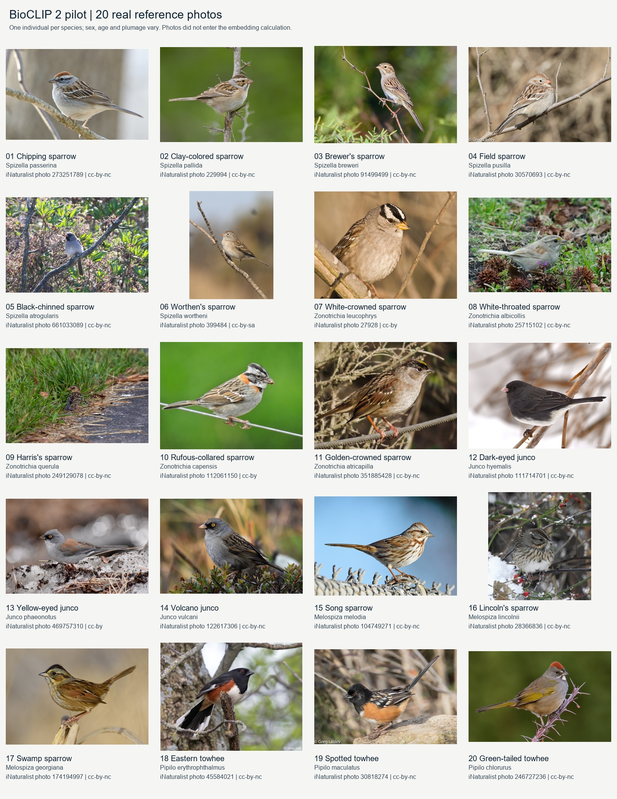

# BioCLIP 2: 20-species starter experiment

Completed on the local RTX 5090. The official BioCLIP 2 text encoder produced a **20 × 768 float32 matrix** from verified full taxonomies for 20 Passerellidae species across five genera. No training was required.

**Result:** all 20 nearest neighbors are in the same genus. The strongest pair is Dark-eyed junco / Yellow-eyed junco (cosine **0.945233**). These are similarities within this hand-selected group, not species-classification accuracy or trait-discovery results.

## Main comparison table

Scores are cosine similarities, not probabilities. Self-matches are excluded. Visual notes describe the selected real photos only and compare each row with its first neighbor.

| Species | Closest match | Second match | Third match | Photo observations |
|---|---|---|---|---|
| **Chipping sparrow** — *Spizella passerina* | Worthen's sparrow (0.9045) | Brewer's sparrow (0.9007) | Clay-colored sparrow (0.8843) | Compared with Worthen's: both reference birds show a rusty cap, pale breast and brown patterned wings; the Chipping reference has a sharper dark eye stripe. Small reference sample. [Photo](https://www.inaturalist.org/photos/273251789) |
| **Clay-colored sparrow** — *Spizella pallida* | Field sparrow (0.9098) | Worthen's sparrow (0.9071) | Brewer's sparrow (0.8906) | Compared with Field: both have brown patterned wings, pale underparts and a small conical bill; the Clay-colored reference has a more strongly outlined cheek, while Field shows a pink bill and pale eye ring. [Photo](https://www.inaturalist.org/photos/229994) |
| **Brewer's sparrow** — *Spizella breweri* | Worthen's sparrow (0.9063) | Chipping sparrow (0.9007) | Clay-colored sparrow (0.8906) | Compared with Worthen's: both have slim bodies, long tails, small bills and brown wing markings. Brewer's reference has a more finely patterned head; Worthen's has a plainer gray face. [Photo](https://www.inaturalist.org/photos/91499499) |
| **Field sparrow** — *Spizella pusilla* | Clay-colored sparrow (0.9098) | Worthen's sparrow (0.9022) | Brewer's sparrow (0.8875) | Compared with Clay-colored: both have pale underparts and brown patterned wings. Field's reference shows a rusty cap and pink bill; Clay-colored shows stronger cheek markings. [Photo](https://www.inaturalist.org/photos/30570693) |
| **Black-chinned sparrow** — *Spizella atrogularis* | Worthen's sparrow (0.8863) | Clay-colored sparrow (0.8780) | Field sparrow (0.8752) | Compared with Worthen's: both show gray faces and pale underparts. The Black-chinned reference shows a darker throat, but the bird is small in the frame, limiting fine-detail comparison. [Photo](https://www.inaturalist.org/photos/661033089) |
| **Worthen's sparrow** — *Spizella wortheni* | Clay-colored sparrow (0.9071) | Brewer's sparrow (0.9063) | Chipping sparrow (0.9045) | Compared with Clay-colored: both have pale underparts, brown patterned wings and small bills. Worthen's reference appears grayer and less strongly patterned around the face. [Photo](https://www.inaturalist.org/photos/399484) |
| **White-crowned sparrow** — *Zonotrichia leucophrys* | Golden-crowned sparrow (0.9115) | Harris's sparrow (0.9038) | White-throated sparrow (0.8978) | Compared with Golden-crowned: both have brown patterned wings and pale gray-brown underparts. The White-crowned reference has bold black-and-white crown stripes; Golden-crowned shows a yellow crown patch. [Photo](https://www.inaturalist.org/photos/27928) |
| **White-throated sparrow** — *Zonotrichia albicollis* | Golden-crowned sparrow (0.9008) | White-crowned sparrow (0.8978) | Rufous-collared sparrow (0.8882) | Compared with Golden-crowned: both show brown patterned wings and grayish underparts. The White-throated reference has a conspicuous pale throat; crown details are less clear at this viewing angle. [Photo](https://www.inaturalist.org/photos/25715102) |
| **Harris's sparrow** — *Zonotrichia querula* | White-crowned sparrow (0.9038) | Golden-crowned sparrow (0.9011) | White-throated sparrow (0.8865) | Compared with White-crowned: the Harris's reference shows a brown patterned back and sparrow-like silhouette, but is distant and facing away. Head and throat differences cannot be assessed reliably from this photo. [Photo](https://www.inaturalist.org/photos/249129078) |
| **Rufous-collared sparrow** — *Zonotrichia capensis* | White-throated sparrow (0.8882) | White-crowned sparrow (0.8832) | Golden-crowned sparrow (0.8800) | Compared with White-throated: both show a patterned head and brown patterned wings. Rufous-collared has a visible rusty collar and stronger dark head stripes in the selected photo. [Photo](https://www.inaturalist.org/photos/112061150) |
| **Golden-crowned sparrow** — *Zonotrichia atricapilla* | White-crowned sparrow (0.9115) | Harris's sparrow (0.9011) | White-throated sparrow (0.9008) | Compared with White-crowned: both show brown patterned wings and pale underparts. Their visible crown colors differ: yellow versus broad black-and-white stripes. [Photo](https://www.inaturalist.org/photos/351885428) |
| **Dark-eyed junco** — *Junco hyemalis* | Yellow-eyed junco (0.9452) | Volcano junco (0.9240) | White-crowned sparrow (0.7913) | Compared with Yellow-eyed: both show compact bodies, conical bills, long tails and gray plumage. The selected Dark-eyed bird has a dark eye and darker head; Yellow-eyed shows a yellow iris and rusty back. Dark-eyed juncos have substantial plumage variation. [Photo](https://www.inaturalist.org/photos/111714701) |
| **Yellow-eyed junco** — *Junco phaeonotus* | Dark-eyed junco (0.9452) | Volcano junco (0.8947) | White-crowned sparrow (0.7993) | Compared with Dark-eyed: both show gray plumage, compact bodies and long tails. Yellow-eyed has a bright iris and rusty back in this photo; the selected Dark-eyed bird has a dark iris and darker head. [Photo](https://www.inaturalist.org/photos/469757310) |
| **Volcano junco** — *Junco vulcani* | Dark-eyed junco (0.9240) | Yellow-eyed junco (0.8947) | Golden-crowned sparrow (0.7699) | Compared with Dark-eyed: both show gray heads, conical bills and compact bodies. Volcano's reference has a yellow eye and more strongly streaked brown upperparts. [Photo](https://www.inaturalist.org/photos/122617306) |
| **Song sparrow** — *Melospiza melodia* | Lincoln's sparrow (0.8311) | Swamp sparrow (0.7767) | Harris's sparrow (0.7650) | Compared with Lincoln's: both references show brown backs, pale eyebrows and dark streaking on pale breasts. Song's streaks appear heavier; Lincoln's photograph is partly obscured by branches. [Photo](https://www.inaturalist.org/photos/104749271) |
| **Lincoln's sparrow** — *Melospiza lincolnii* | Song sparrow (0.8311) | Harris's sparrow (0.7582) | Dark-eyed junco (0.7481) | Compared with Song: both show brown plumage and breast streaking. Lincoln's reference has finer visible streaks, although branches and lighting limit the comparison. [Photo](https://www.inaturalist.org/photos/28366836) |
| **Swamp sparrow** — *Melospiza georgiana* | Song sparrow (0.7767) | Lincoln's sparrow (0.7245) | Clay-colored sparrow (0.6945) | Compared with Song: both have brown wings, patterned heads and long tails. Swamp's reference has warmer rusty wing coloration and less conspicuous breast streaking. [Photo](https://www.inaturalist.org/photos/174194997) |
| **Eastern towhee** — *Pipilo erythrophthalmus* | Spotted towhee (0.8458) | Yellow-eyed junco (0.7718) | Dark-eyed junco (0.7642) | Compared with Spotted: both selected birds show dark heads and backs, rusty sides and pale bellies. The Spotted reference has much more conspicuous white spotting on its wings/back. [Photo](https://www.inaturalist.org/photos/45584021) |
| **Spotted towhee** — *Pipilo maculatus* | Eastern towhee (0.8458) | Green-tailed towhee (0.7818) | Song sparrow (0.7473) | Compared with Eastern: both selected birds show dark heads, rusty sides and pale bellies. White spots across the Spotted reference's wings/back provide a clear visual difference. [Photo](https://www.inaturalist.org/photos/30818274) |
| **Green-tailed towhee** — *Pipilo chlorurus* | Spotted towhee (0.7818) | Eastern towhee (0.7350) | Clay-colored sparrow (0.7061) | Compared with Spotted: both show a long tail and conical bill, but coloration differs strongly. Green-tailed has olive-yellow wing/tail edges, gray underparts, a white throat and rusty cap; Spotted has a dark head, rusty sides and white wing spots. Same-genus proximity need not imply overall color similarity. [Photo](https://www.inaturalist.org/photos/246727236) |

## Three useful comparisons

- **Dark-eyed vs Yellow-eyed junco — 0.9452:** strongest embedding pair. Gray plumage and overall form are similar, while eye color and back/head coloration differ in these references.
- **White-crowned vs Golden-crowned sparrow — 0.9115:** similar brown wings and pale underparts, but visibly different crown markings.
- **Eastern vs Spotted towhee — 0.8458:** similar dark heads, rusty sides and pale bellies; white wing/back spotting is a promising candidate trait for a later controlled edit.

## Reference photos

These photos were inspected for the notes above; they were not fed to the text encoder. One photo per species does not cover sex, age, season or subspecies variation. The Harris's sparrow reference is distant and faces away; the Black-chinned sparrow is small in the frame. No fine-detail conclusions were drawn from those views. Full attribution and source links appear in [photo credits](photo_credits.md).

## Method and reproducibility

1. Hand-select 20 species from Spizella (6), Zonotrichia (5), Junco (3), Melospiza (3), and Pipilo (3). All belong to Passerellidae.
2. Verify each complete taxonomy using an exact, accepted species match in the GBIF API. Save all source responses.
3. Encode the literal string `Kingdom, Phylum, Class, Order, Family, Genus, specific epithet`. No common name, extra natural-language prefix or prompt averaging is used.
4. Load the official `imageomics/bioclip-2` configuration and safetensors checkpoint at a pinned revision. Use OpenCLIP `encode_text(..., normalize=False)` in evaluation mode, float32, with gradients disabled.
5. Save raw vectors. Separately L2-normalize them and compute the pairwise dot products to obtain cosine similarity. Sort descending and exclude self-matches.
6. Obtain exact-name-matched iNaturalist reference photos and inspect their visible appearance. Store the photo sources, attribution and licenses separately from the model measurements.

**Model revision:** `2957b322090f9cb17ae72c71981c7218a28d81e0`. Full package versions, SHA-256 hashes, exact inputs, GPU and validation results are in [run metadata](run_metadata.json).

## Verification

- Exactly 20 unique species, 20 nontruncated token sequences and 768 finite coordinates per vector.
- Cosine matrix is symmetric; diagonal entries are one within numerical tolerance; values lie in the valid range.
- Batch extraction agrees with extracting each species separately; maximum absolute raw-vector difference: **5.7220459e-06**.
- Nearest matches exclude the query species. All 20 have a same-genus first match; 49 of 60 top-three neighbor slots are same-genus.
- All 20 reference image files were opened and visually inspected in the contact sheet. Dependency consistency check passed.

## What this does and does not establish

**Established:** pretrained BioCLIP 2 runs successfully on this PC, produces the expected vector shape, and yields coherent within-genus neighbors for this pilot.

**Not established:** individual biological trait dimensions, causal control, full-dataset performance, or exact compatibility with the TreeOfLife-1M TaxaAdapter checkpoint. Related species share much of the input taxonomy string, so similarity may reflect shared taxonomic text as well as learned visual information. Photo observations do not explain which embedding coordinates cause a match. The 20 species have not been verified as members of the TaxaAdapter training subset.

This uses the projected, pooled BioCLIP 2 text output. Before connecting it to TaxaAdapter or training the full SAE, verify the generator checkpoint's exact text formatting, pooling and normalization. Twenty vectors are a pipeline smoke test, not an adequate basis for a large trait-discovery SAE.

## Files

- `species_comparison.csv`: the requested 20-row table, three nearest matches, scores, photo observations and source links.
- `embeddings_raw.npy` / `embeddings_raw.csv`: unnormalized 20 × 768 vectors in the order listed in `run_metadata.json`.
- `embeddings_normalized.npy`: unit-length copies used for cosine similarity.
- `cosine_similarity.npy` / `cosine_similarity.csv`: full 20 × 20 matrix.
- `nearest_neighbors.json` / `nearest_neighbors.csv`: measured top-three matches without visual interpretation.
- `reference_photos.jpg`, `photo_credits.md`: inspected photo overview and attribution.

## Sources

- [Official BioCLIP 2 model](https://huggingface.co/imageomics/bioclip-2)
- [Official BioCLIP 2 project](https://imageomics.github.io/bioclip-2/)
- GBIF taxonomy URLs are recorded for every row in `../data/species.csv`.
- iNaturalist photo and taxon URLs are recorded in `../data/photo_references.json`; local source responses are in `../data/sources/`.

Suggested next step: select several clear species pairs from this table and expand the taxonomy embedding collection substantially before training an SAE.
