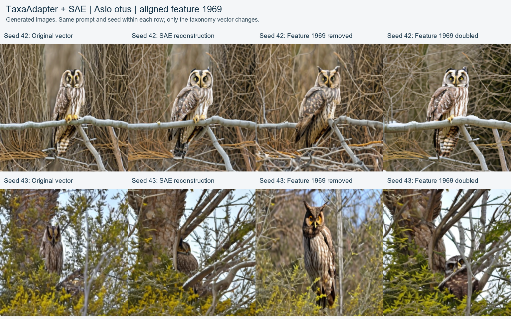

# TaxaAdapter generation experiments

## Inspect a one-feature edit

Open the [house sparrow yellow-feature sheet](experiments/feature_gallery_v2/sheet_add_766_Passer_domesticus.png). Follow one seed across the original, increasing strengths and random control. Compare the bird's plumage, the background and whether the animal keeps its shape. Repeat on the other seeds before looking at the selected examples in the [gallery report](experiments/feature_gallery_v2/REPORT.md).

To trace the implementation, read the [gallery configuration](configs/feature_gallery_v2.json) for the selected species and features, then [run_feature_gallery.py](run_feature_gallery.py) for target activation levels and matched random controls. The [technical guide](../../TECHNICAL_GUIDE.md) derives the residual-preserving edit. The adapter override in [run_interventions.py](run_interventions.py) shows where the resulting 768-vector enters the generator. Use the [experiment index](experiments/README.md) to find the corresponding control or benchmark.

Across the two galleries, orange 938, red 709 and yellow 766 showed the clearest colour shifts in the unblinded review. Some edits also changed anatomy or scene colour. The [blind scoring package](experiments/blind_colour_review_v1/README.md) documents the independent review procedure. The [potoo](experiments/expanded_bridge_potoo_v1/REPORT.md) and [owl](experiments/expanded_bridge_owl_v1/REPORT.md) studies show what happens when multiple coordinates are changed one at a time.

**Human review and trait validation.** [follow-up report](experiments/trait_followup_2026_10_07/REPORT.md) and [completed human review](experiments/human_review_2026_10_07/REPORT.md). The reviewer judged **27/32 unedited ladybird images scorable, including exactly seven visible spots in 3/27; five images remain NA**. This is one human review with substantial unresolved view-eligibility disagreement against the earlier [provisional AI screening](experiments/unedited_dorsal_v1/AI_REVIEW_PROVISIONAL.md). The [original review page](experiments/unedited_dorsal_v1/human_review/review.html) remains available; the linked human report preserves the supplied export and explicit clarification.

The new endpoint is the natural log of species-mean tail length divided by species-mean wing length. Training selected feature **814** from the 732 recurrent SAE features. It failed validation: family-centered correlation changed from **-0.1467** in training to **+0.0803** in validation, and adding activation did not improve prediction over taxonomy. The prespecified gate stopped the follow-up before test endpoint computation or the tail-image branch. The existing SAE was reused without retraining.

The [expanded report](experiments/expanded_followup_2026_10_04/REPORT.md) retains **362,460 corrected TreeOfLife-10M records with raw 768-dimensional space-formatted embeddings**, **732/2,048 features passing the unchanged recurrence gate across all five new seeds**, and the **98-image exploratory ladybird bridge**. The independent raw-vector beak-shape probe and training-selected SAE candidate failed validation. These results do not establish isolated biological trait control. The exact TreeOfLife-1M training manifest remains unavailable, so this broader corpus is not claimed as exact adapter-training coverage.

The earlier [5,388-species stability study](experiments/followup_2026_10_04/REPORT.md) found zero passing features on its smaller corpus. Its findings, the [188-image continuation](experiments/existing_sae_v1/REPORT.md), [saved-image viewer](experiments/existing_sae_v1/viewer.html) and [verification](experiments/existing_sae_v1/verification.json) remain historical records; human review of the older 28-image ladybird set remains deferred. The preliminary expanded v1 was superseded after source-quality corrections; use corrected v2 artifacts. The [method scope note](experiments/expanded_followup_2026_10_04/METHOD_SCOPE.md) explains correspondence to the two reference papers.

## Initial generation pilot

The official TreeOfLife-1M adapter checkpoint runs on this PC, and a first controlled SAE intervention comparison has been generated.



The comparison shows one species, *Asio otus* (Long-eared Owl), with seeds 42 and 43. Each row uses the same prompt, seed, DDIM scheduler, 50 diffusion steps, guidance 6, adapter scale 1, and 512 x 512 resolution. Columns use the original BioCLIP vector, its unedited SAE reconstruction, one SAE feature removed, and that feature doubled. These are model-generated images, not reference photographs.

## What changed in the embedding pipeline

The released TaxaAdapter code loads BioCLIP 2 and encodes taxonomy levels separated by **spaces**. The earlier Task 5 pilot used comma-space separators. Their mean embedding cosine over the same 5,388 species is only **0.8257**, so treating them as interchangeable would be a material mismatch.

A separate SAE was therefore fitted to newly extracted space-formatted raw embeddings. It uses the same species, genus splits, architecture, training seed, and selection rule as the original pilot. The original comma-formatted experiment remains a separate recorded result. Held-out test genera in this aligned run explain **54.14%** of variation relative to the training mean, with mean reconstruction cosine **0.8712**. This subset is still not the complete TreeOfLife species list or a confirmed exact adapter training list.

The chosen aligned feature is **1969**, with activation **6.7547** in this species. It was selected from active features using only the top training examples: at least seven of eight examples in Strigidae and at least two genera, then strongest activation in the chosen species. Seven examples are owls and one is a potoo. This establishes an association for choosing an exploratory intervention; it does not assign a specific independent trait. Feature 1969 belongs to the newly trained aligned SAE, and is unrelated to indices in the earlier candidate-feature report.

## What the images show

In seed 42, the bird remains on a similar perch across conditions, but its orientation and body/plumage appearance change. In seed 43, the unedited reconstruction already changes the bird's position and visibility, and the edited images also change pose and framing. These are manual observations of the displayed images, not measured trait scores.

The historical pilot demonstrates a working path from an SAE code, through a reconstructed BioCLIP vector, to an image. It does **not** establish a clean biological trait control. Reconstruction itself is a confound, and single-feature edits can affect scene layout. These limitations motivated the later controlled continuation and expanded recurrence/trait tests linked above.

## Reproduce the initial pilot (includes SAE training)

The inference-only continuation has its own [reproduction commands](experiments/existing_sae_v1/REPORT.md#reproduce-the-inference-only-continuation). The initial preparation sequence below invokes SAE training in `prepare_alignment.py`. The stability study used a separate [stability runner](run_aligned_stability.py), preserving the original aligned artifacts.

Use a separate Python 3.12 environment with CUDA PyTorch compatible with the GPU. Run all commands from the `bioclip-trait-discovery` repository root. Install the BioCLIP dependencies listed below together with the generation requirements. The root `requirements.txt` pins `huggingface_hub==2.0.0`, while this inference stack uses `huggingface_hub==0.36.0`; passing both files to one installer creates a version conflict.

```powershell
py -3.12 -m venv .venv-taxaadapter
& ./.venv-taxaadapter/Scripts/python.exe -m pip install torch==2.11.0 torchvision==0.26.0 --index-url https://download.pytorch.org/whl/cu130
& ./.venv-taxaadapter/Scripts/python.exe -m pip install numpy==2.3.2 pillow==11.3.0 open_clip_torch==3.3.0 safetensors==0.8.0 -r task5_bioclip_sae/generation/requirements.txt
& ./.venv-taxaadapter/Scripts/python.exe task4_bioclip_pilot/download_model.py
& ./.venv-taxaadapter/Scripts/python.exe task5_bioclip_sae/generation/download_assets.py
& ./.venv-taxaadapter/Scripts/python.exe task5_bioclip_sae/generation/download_diffusion_assets.py
& ./.venv-taxaadapter/Scripts/python.exe task5_bioclip_sae/prepare_embeddings.py
& ./.venv-taxaadapter/Scripts/python.exe task5_bioclip_sae/generation/prepare_alignment.py
& ./.venv-taxaadapter/Scripts/python.exe task5_bioclip_sae/generation/run_interventions.py
& ./.venv-taxaadapter/Scripts/python.exe task5_bioclip_sae/generation/verify_interventions.py
```

`prepare_embeddings.py` creates the original comma-formatted vectors needed by `prepare_alignment.py` to measure the format difference. Skip that step only when those original vectors and matching species records already exist. The original comma-formatted SAE does not need to be trained to run this generation sequence. `prepare_alignment.py` invokes `train_sae.py` with its output directory redirected to `generation/cache/aligned/`.

Downloads and aligned arrays/SAE weights live under `cache/`, excluded from Git. The tested local environment reads the existing PyTorch and BioCLIP dependencies through a `.pth` file and adds diffusion dependencies separately; the commands above describe an independent installation, which was not freshly tested. Scripts use the recorded 5,388-species dataset and contain size assertions; changing the dataset requires code and verification changes, not just replacing the species file.

Both preparation and generation accept `--bioclip-model-path` to reuse an existing pinned model folder. On this PC the existing model is at `../task4_bioclip_pilot/cache/model/`, relative to the repository root. A new clone's `download_model.py` places it inside this repository at `task4_bioclip_pilot/cache/model/`, which is the default. The original `prepare_embeddings.py` always uses that default path and has no model-path option.

`run_interventions.py` accepts `--species`, `--seeds`, `--prompt`, `--guidance` and `--steps`. It writes to the same `results/` folder and updates `feature_selection.json`; preserve this run before changing inputs. The species must occur in the saved rows and have an active feature satisfying the family-selection rule. There is currently no `--feature` or `--out-dir` option. `verify_interventions.py` checks the recorded default coverage of four conditions for seeds 42 and 43, so it must be adapted for a different seed list.

## Script and artifact map

| Script | Inputs and behavior | Main outputs |
| --- | --- | --- |
| [download_assets.py](download_assets.py) | Retrieves the pinned upstream source and TreeOfLife-1M adapter | `cache/upstream/`, `cache/adapter/`, [assets.json](assets.json) |
| [download_diffusion_assets.py](download_diffusion_assets.py) | Retrieves pinned SD 1.5 FP16 components and the MSE VAE | `cache/sd15/`, `cache/vae/`, [diffusion_assets.json](diffusion_assets.json) |
| [prepare_alignment.py](prepare_alignment.py) | Uses original species/splits and embeddings, extracts space-formatted vectors, reuses the existing SAE trainer | `cache/aligned/data/`, `cache/aligned/results/`, [format_comparison.json](format_comparison.json), [aligned_evaluation.json](aligned_evaluation.json) |
| [run_interventions.py](run_interventions.py) | Loads aligned SAE and frozen models, selects one feature, generates the four conditions per seed | [feature_selection.json](feature_selection.json), eight PNGs, [comparison.png](results/comparison.png), [run_manifest.json](results/run_manifest.json) |
| [verify_interventions.py](verify_interventions.py) | Recomputes reconstruction metrics and checks saved artifacts, hashes and recorded runtime assertions | [verification.json](results/verification.json) |

Verification of the initial pilot requires the ignored local arrays, checkpoints and upstream cache. A fresh clone must restore those assets; the preparation commands above include SAE training. The original metadata list contains 10,000 iNat21 species, and its pilot extraction script filters to 5,388 Animalia. The current expanded workflow separately extracted 362,460 corrected TreeOfLife-10M taxonomy records; exact TreeOfLife-1M membership remains unavailable. Follow the [expanded report](experiments/expanded_followup_2026_10_04/REPORT.md) for current scripts, preserved protocols and artifact locations.

## Inference-only continuation scripts

| Script | Purpose |
| --- | --- |
| [experiment_common.py](experiment_common.py) | Read saved embeddings/codes/SAE parameters and apply the frozen linear decoder |
| [analyze_overlap.py](analyze_overlap.py) | Rank top ten support-overlap neighbors for all recorded species |
| [run_frozen_experiments.py](run_frozen_experiments.py) | Prepare residual-preserving controls and exact one-coordinate paths, then generate images with frozen modules |
| [verify_frozen_experiments.py](verify_frozen_experiments.py) | Independently check overlap, decoder math, bridge endpoints, frozen-weight records and image hashes |
| [summarize_frozen_experiments.py](summarize_frozen_experiments.py) | Save species-alignment proxy tables and static scientific figures |
| [build_frozen_viewer.py](build_frozen_viewer.py) | Build an offline viewer of saved images; selecting a frame does not run a model |
| [audit_species_sources.py](audit_species_sources.py) | Inspect released metadata lists without downloading images or running training |

## Adapter integration

The runner adds a precomputed-vector path to the released adapter, retaining its learned projection, taxonomy attention, unconditional zero-vector branch and diffusion sampler. Exact projection equivalence was checked against the original token-based path. The unused TaxaBind encoder is replaced by an identity placeholder in this BioCLIP-only run. All generated images use the upstream default negative prompt. The FP32 raw input and upstream FP16 BioCLIP output have cosine 0.9999991 for this species. Small numerical/platform changes can affect subsequent generation or SAE feature indices.

## Provenance and checks

- [Official code](https://github.com/Imageomics/TaxaAdapter), commit `1f8f64a53b2d5ac88aaa1e98ea0ed12e35b4a506`.
- [Official pretrained weights](https://huggingface.co/mridulk/TaxaAdapter), revision `b70f29d0d5f834e8d3f3718e00e055646874e430`, file `taxaadapter_tol-1m.bin` (86.1 MB), SHA256 in `assets.json`.
- BioCLIP 2 uses the same pinned revision as the previous pilot, `2957b322090f9cb17ae72c71981c7218a28d81e0`.
- The upstream SD 1.5 model URL redirects to `stable-diffusion-v1-5/stable-diffusion-v1-5`, pinned here at `451f4fe16113bff5a5d2269ed5ad43b0592e9a14`; the upstream VAE is pinned at `31f26fdeee1355a5c34592e401dd41e45d25a493`. See `diffusion_assets.json` and their upstream model cards for licensing.
- `results/run_manifest.json`: prompt, seeds, settings, input distances, package versions, checkpoint hashes and image hashes.
- `format_comparison.json`, `aligned_evaluation.json`, `aligned_provenance.json`, `feature_selection.json`: format alignment, SAE evaluation and candidate selection.
- `results/verification.json`: independent metric recomputation, split/sparsity checks, CPU checkpoint round-trip, source/checkpoint/image hashes, and recorded runtime checks of vector injection and decoder edits.

Official code and weights retain their upstream MIT license. Diffusion and VAE models retain their own terms. Upstream source is cached with its original LICENSE; no pretrained weights are committed.
