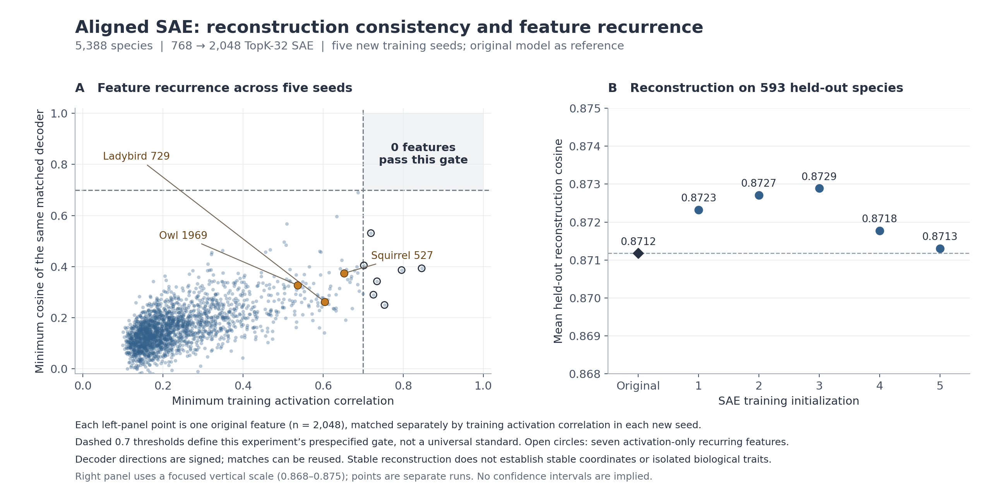

# Aligned SAE seed-stability experiment

Completed 2026-10-04T06:54:51.944779+00:00. **0/2,048 original features pass the prespecified stability gate across all five new seeds.** 7 features recur under the activation-only criterion.

[PDF figure](stability_summary.pdf) · [Figure provenance](figure_provenance.json) · [Independent audit](independent_audit.json)

## Protocol

Five new seeds (1–5) used the same 5,388 generator-aligned, space-separated BioCLIP 2 taxonomy embeddings, fixed whole-genus splits, 768→2,048 TopK-32 architecture, optimizer and validation selection as the original SAE. The original seed 20260929 was retrained solely as a reproduction control. Original artifacts were not modified. BioCLIP and TaxaAdapter were not trained.

Before training, `protocol.json` fixed the candidate gate: training activation correlation ≥0.7 **and** cosine of the same matched decoder direction ≥0.7 in every new seed. Validation activation correlation is reported as confirmation, not used to choose matches. Matching maximizes signed training Pearson correlation independently for each original feature. Sign flips are not allowed because codes are nonnegative. SciPy was unavailable; best matches can reuse features, with collisions reported for every pair in `all_feature_matches.csv`. This is recurrence relative to the original SAE, not an all-pairs proof or a test of biological trait identity.

Validation species also selected the SAE checkpoint by reconstruction error. Their activation correlations are a descriptive generalization check, not an untouched confirmatory test. The 0.7 thresholds are this experiment's conservative decision rule, not universal biological validity criteria.

## Selected candidates

| Original feature | Candidate | Min training correlation | Min same-pair decoder cosine | Min validation correlation | Passes gate |
|---:|---|---:|---:|---:|---|
| 729 | ladybird candidate | 0.6035 | 0.2627 | 0.5728 | False |
| 1969 | owl candidate | 0.5357 | 0.3276 | 0.7125 | False |
| 527 | squirrel candidate | 0.6525 | 0.3743 | -0.0052 | False |

## Reconstruction and validation

| Seed | Best epoch | Test explained variance | Test cosine | Original features in match collisions |
|---:|---:|---:|---:|---:|
| 20260929 | 15 | 0.5414 | 0.8712 | reproduction only |
| 1 | 15 | 0.5456 | 0.8723 | 1533 |
| 2 | 15 | 0.5471 | 0.8727 | 1540 |
| 3 | 15 | 0.5478 | 0.8729 | 1554 |
| 4 | 15 | 0.5437 | 0.8718 | 1554 |
| 5 | 15 | 0.5430 | 0.8713 | 1552 |

Original-seed reproduction passed: True; maximum state difference 0, maximum activation difference 0. All source hashes remained unchanged. Selected-feature correlations and decoder cosines were independently recomputed in NumPy float64 and agree within 2e-5. Whole-genus split separation, finite outputs and TopK bounds were checked.

A separate CPU-only audit also passed: all 15 selected matches were independently searched over all 2,048 candidate features, all 2,048 gate decisions were reproduced, and checkpoint selection, source hashes, saved checkpoint hashes, and finite/nonnegative TopK codes were verified. See [independent_audit.json](independent_audit.json).

Null references use a random decoder dictionary and one independent shuffled-species permutation for each trained seed. These describe chance best-match behavior and are not calibrated p-values; sparse activation patterns and searching 2,048 possible matches can produce high null maxima.

## Interpretation and next step

No feature meets the predeclared combined recurrence gate. Do not promote the existing ladybird/owl/squirrel dimensions as stable biological traits, and do not relax thresholds after seeing the result. Existing image edits remain exploratory responses to one fitted coordinate system. Any further generation of these leads should be explicitly exploratory; a confirmatory trait experiment must first establish a reproducible representation or reproducible feature group.

As a post-result diagnostic, even allowing each feature to choose the **best decoder-cosine match independently of activation matching**, zero features reach cosine 0.7 in all five seeds (the highest minimum is 0.6909). Thus the absence of passing candidates is not solely caused by activation-based matching or repeated matches.

The seven activation-only recurring features are 326, 828, 1330, 1446, 1449, 1515, and 1866. Their original top-eight training species contain a mixed-family group, bees (Apidae), gulls/terns (Laridae), three reptile-associated groups, and spiders. None has positive original activation in `Coccinella septempunctata`, `Nyctibius griseus`, or `Nyctibius jamaicensis`; none passes the combined gate. This diagnostic supplies no replacement ladybird or potoo candidate. Full species lists and activations are in [activation_only_diagnostic.json](activation_only_diagnostic.json).

The 5,388 species pilot is not the full TreeOfLife-1M species set. Taxonomy-associated activations may encode names and relatedness rather than separable morphology. Hardware snapshots were collected before/after every seed in `hardware.jsonl`; no fallback or retry was used.

Across those hardware snapshots, total GPU use peaked at 5,025 MiB and sampled temperature at 40°C. The maximum per-run PyTorch allocated-memory peak was 402,849,792 bytes (384.2 MiB). No OOM or hardware error occurred. Six fits plus analysis took 26.9 seconds; figure production and independent audit were additional CPU-only work.

## Files

- `protocol.json`: protocol saved before training, source and script hashes.
- `summary.json`, `metrics_seed*.json`: complete reconstruction and stability metrics.
- `all_feature_matches.csv`, `selected_feature_matches.csv`, `feature_stability.csv`: inspectable matching results, collision counts, conservative gate.
- `*_correlations.npy`, `same_match_decoder_cosines.npy`, `matched_features.npy`: all-feature matching arrays, in seed order 1–5.
- `sae_seed*.pt`, `sparse_vectors_seed*.npy`, `training_history_seed*.csv`: saved trained outputs; input artifacts preserved.
- `hardware.jsonl`, `reproduction.json`: hardware monitoring and original-seed control.
