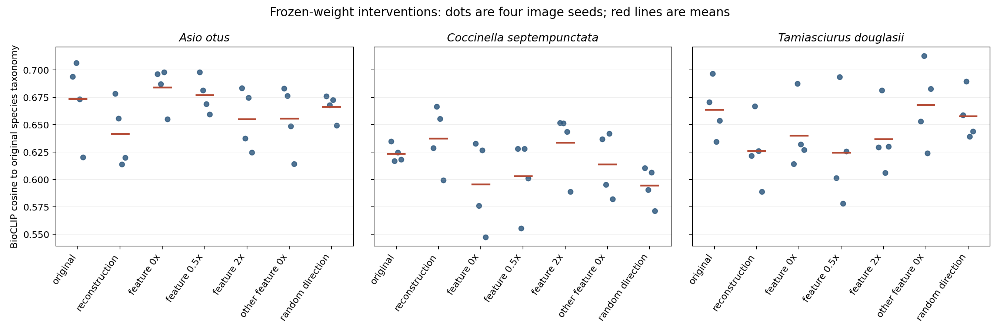
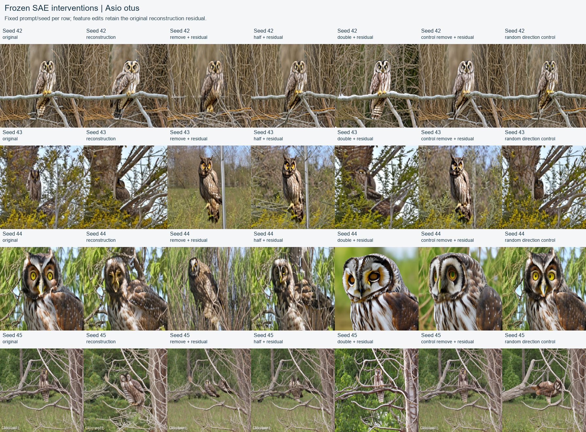
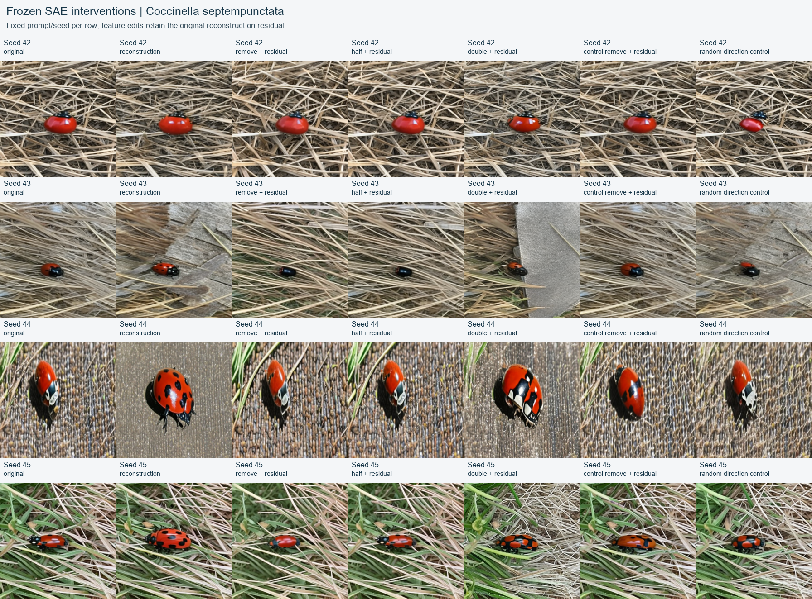
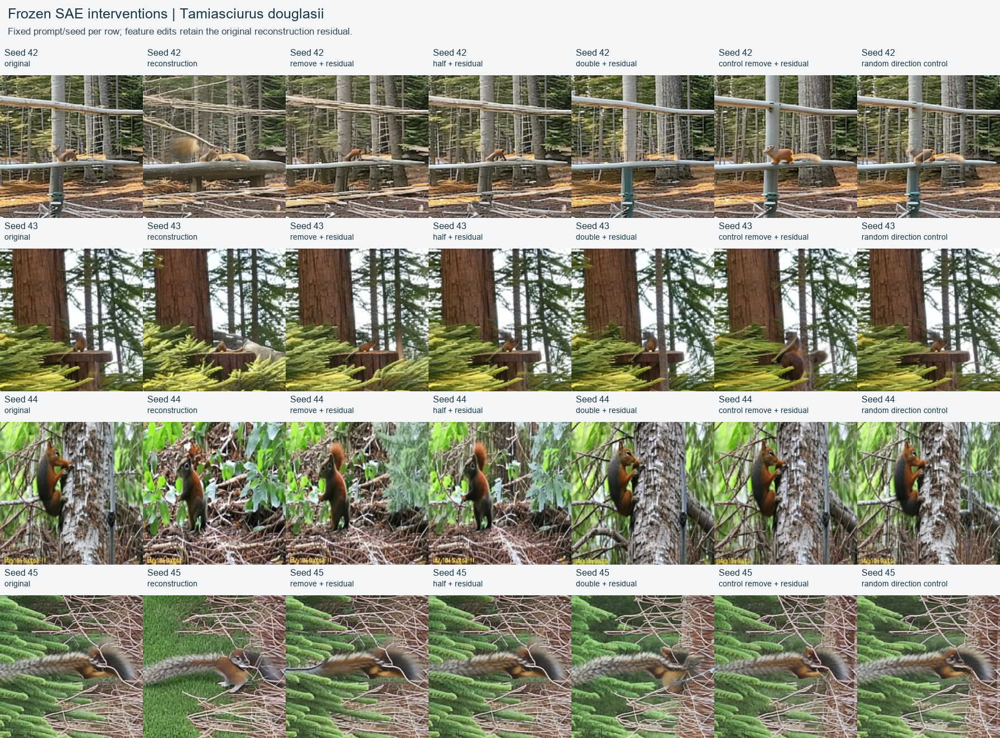
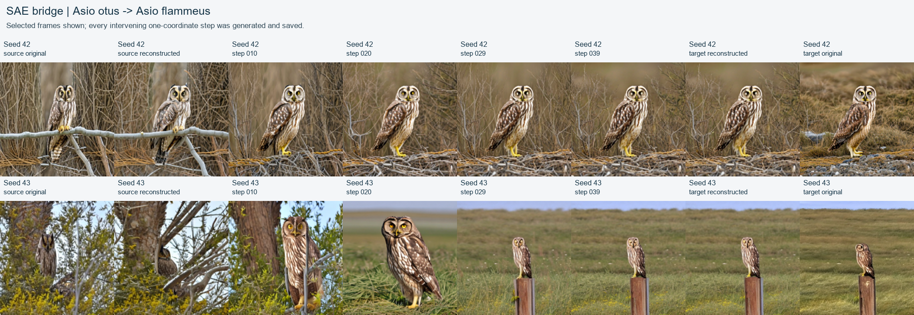
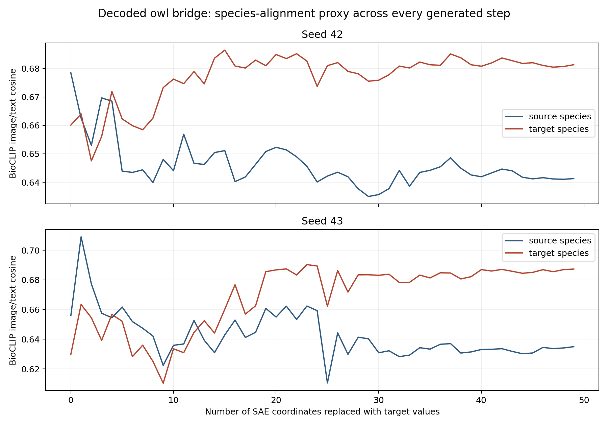

# Existing-SAE interventions and species bridge

Completed October 2, 2026. **No training was run.** This continuation reads the existing space-formatted BioCLIP 2 embeddings and aligned SAE checkpoint, freezes the generator modules, and saves results in a new directory. The original eight-image pilot is preserved.

Open the [interactive viewer](viewer.html) to inspect conditions, seeds and every bridge step. The viewer selects saved images; it does not execute a model. [Verification](verification.json) passed for all **188 images**, vector-edit math, exact bridge endpoints, input hashes and unchanged checkpoints.

## What is now complete

| Assigned step | This continuation |
| --- | --- |
| Sparse-support similarity | Top ten neighbors for all 5,388 recorded species: 53,880 ranked pairs |
| Feature edits | 84 images: three species, four seeds and seven conditions, including reconstruction-residual preservation and controls |
| Species bridge | 104 owl images: 49 consecutive one-coordinate edits, two seeds, reconstructed endpoints and separate original endpoint references |

The full TreeOfLife-1M species list, full-coverage embeddings/SAE, and verified independent biological traits remain unfinished.

## Binary overlap retrieval

Supports use activation > 1e-7. All natural saved codes have 32 active coordinates. Neighbors maximize intersection size, equivalent to maximizing Jaccard for these fixed-size supports. Self matches are excluded. Equal-overlap ties use scientific-name alphabetical order and are recorded.

| Example source | Closest species | Shared coordinates | Jaccard |
| --- | --- | ---: | ---: |
| *Asio otus* | *Asio flammeus* | 15 / 32 | 0.3061 |
| *Coccinella septempunctata* | *Coccinella undecimpunctata* | 14 / 32 | 0.2800 |
| *Tamiasciurus douglasii* | *Tamiasciurus hudsonicus* | 16 / 32 | 0.3333 |

Across the 5,388 queries, the closest species shares **11.4256** coordinates on average, versus **0.6886** for one uniformly sampled non-self peer per query. **54.51%** of closest neighbors share the genus; **79.94%** share the family. **28.80%** of queries have a tie for the highest overlap. These are descriptive retrieval results across all saved splits, not a held-out prediction benchmark or evidence of a particular visual trait.

[Neighbor table](../../overlap/neighbors.csv) · [Overlap summary and provenance](../../overlap/summary.json). Verification independently checked all 53,880 reported intersections using Python sets, and exhaustively recomputed candidate rankings for 128 sampled queries.

## Residual-preserving feature interventions

For original embedding x, sparse code z and linear SAE decoder D, edited inputs are:

**x′ = x + D(z′) − D(z).**

This adds back the original reconstruction residual, following the intervention framework in [Interpretable and Testable Vision Features via Sparse Autoencoders, Section 3.2](https://arxiv.org/html/2502.06755v2). A zero edit therefore returns the original embedding. The unedited reconstruction is also generated as a separate diagnostic.

The seven conditions are original embedding, unedited reconstruction, selected activation at 0×, 0.5× and 2× with residual preservation, a different active feature removed with residual preservation, and a random direction with the same input-change norm as selected-feature removal. The random direction is orthogonal to the selected decoder direction and uses a recorded fixed seed. The active-feature control has at most 25% same-family species among its training top examples and is selected for the closest removal norm; it is **not** exactly magnitude-matched or established as biologically unrelated.

Candidates use the earlier rule: strongest active feature with at least seven of eight top training examples in the source family and at least two genera. Aligned feature IDs are 1969 for the owl, 729 for the ladybird and 527 for the squirrel. They are family-associated candidates, not established labels for ear tufts, spot count or tail shape.

Every condition uses seeds 42–45, the same generic text prompt, 50 DDIM steps, guidance 6, adapter scale 1 and 512 × 512 resolution. Species names are not added to the ordinary diffusion text prompt. Selection precedes generation and does not use image results.

### Species-alignment proxy

The following averages use the frozen BioCLIP 2 image encoder and the original taxonomy vector. The evaluation model is also part of the conditioning pipeline: these scores are an internal species-alignment proxy, not independent biological trait validation. Four seeds are shown individually in the figure; no significance or confidence claims are made.

| Species | Original | Reconstruction | Feature 0× | Feature 0.5× | Feature 2× | Other feature 0× | Random direction |
| --- | ---: | ---: | ---: | ---: | ---: | ---: | ---: |
| *Asio otus* | 0.6737 | 0.6421 | 0.6843 | 0.6770 | 0.6552 | 0.6558 | 0.6666 |
| *Coccinella septempunctata* | 0.6237 | 0.6376 | 0.5958 | 0.6033 | 0.6339 | 0.6141 | 0.5948 |
| *Tamiasciurus douglasii* | 0.6640 | 0.6260 | 0.6403 | 0.6247 | 0.6368 | 0.6683 | 0.6580 |



Removing the owl candidate does not decrease its average source-species alignment. Removing the ladybird candidate decreases alignment, but the random-direction control produces a similar average decrease. Squirrel responses are not ordered monotonically by activation. These results do not support a simple assumption that an associated feature is a clean, independently controllable trait.

### Manual image observations

The three panels were visually inspected. These observations are qualitative, not annotations or measured trait scores.

- Owl edits change face appearance, orientation, body scale and framing. In seed 44, doubling the candidate changes the prominent ear-tuft appearance along with other head/body details; this is not a replicated, isolated ear-tuft effect.
- Ladybird edits change visible red/black body regions, spot-like markings and sometimes object placement. Reconstruction alone also changes these attributes; no consistent spot-count control is demonstrated.
- Squirrel edits change body/tail appearance and placement in some seeds. Many animals are small in the frame, limiting morphology assessment.







[Per-condition scores](intervention_scores.csv) include mean RGB differences. RGB differences measure all scene changes and must not be interpreted as trait scores.

## Long-eared to short-eared owl bridge

The destination is the highest-overlap species, *Asio flammeus*, selected before image generation. Its code shares 15 coordinates with *Asio otus*. Their union contains 49 coordinates, all of whose activation values differ. The path replaces **one coordinate per step** with the target value, ordered by absolute activation change times decoder-direction norm; ties use feature index.

The code reaches the exact target code after 49 edits. Every state from step 0 to 49 was generated for seeds 42 and 43. The path starts at the source reconstruction and ends at the target reconstruction. Original source and target vectors are generated separately; no claim is made that the decoded endpoint equals the raw target embedding. No TopK operation is applied after editing, because that would change additional coordinates. The maximum support size on this path is 35.



Only selected frames are displayed above; all adjacent one-coordinate states are saved and available in the viewer.

| Seed | Target minus source alignment at start | At end | Gain | Steps with non-decreasing relative target alignment |
| --- | ---: | ---: | ---: | ---: |
| 42 | -0.0184 | 0.0401 | +0.0584 | 25 / 49 |
| 43 | -0.0261 | 0.0523 | +0.0784 | 28 / 49 |

The proxy shifts toward the destination at both endpoints, but the per-step response is not monotonic. Visual inspection also shows pose/framing/background changes, especially for seed 43. This establishes an implemented representation-space bridge and an initial generated example, not a sequence of isolated biological trait substitutions. Different coordinate orders, species pairs and image seeds still need study.



[Every bridge step and score](bridge_scores.csv) · [Numerical protocol](protocol.json) · [Runtime manifest](run_manifest.json) · [Summary](summary.json).

## Species coverage audit

The [source audit](../../species_source_audit.json) inspected the pinned official code, current adapter model file listing and TreeOfLife-10M metadata listing. The pinned code supplies a 1,103-record one-per-family subset; the exact TreeOfLife-1M training-species manifest was not identified in these sources. The broader TreeOfLife-10M naming/taxonomy files cannot be substituted while claiming exact TreeOfLife-1M coverage. This bounded audit does not exclude another release elsewhere.

## Training boundary and proposed next step

The user requested a pause before any training. **No encoder, generator or SAE was fitted or updated in this continuation.** Existing input/checkpoint hashes remain unchanged; all generator parameters had requires_grad=False during inference.

The next proposed training experiment is a five-initialization stability check of the **aligned** SAE. It would reuse the existing 5,388 embeddings and genus splits, width 2,048, TopK 32, training-only centering/RMS, Adam learning rate 0.001, batch size 256, maximum 200 epochs and the existing validation selection/early-stopping rule. Seeds 1–5 would write separate checkpoints under a new cache directory, preserving the current SAE. Matched-feature activation correlations and decoder-direction cosines would be checked before repeating interventions. This training has **not been launched**.

Full-species training would additionally require a verified target species manifest and new frozen-encoder extraction. Trait specificity still requires prespecified visible traits, annotations or an independent trait evaluator, stronger controls, and replication across species and SAE initializations.

## Reproduce the inference-only continuation

Use the existing prepared environment and existing aligned cache. These commands do not call the training scripts. They refuse to overwrite an existing output directory; choose a new directory to repeat generation.

```powershell
# From the bioclip-trait-discovery repository root:
& ./.venv-taxaadapter/Scripts/python.exe task5_bioclip_sae/generation/analyze_overlap.py --out-dir task5_bioclip_sae/generation/overlap_repeat
& ./.venv-taxaadapter/Scripts/python.exe task5_bioclip_sae/generation/run_frozen_experiments.py --bioclip-model-path ../task4_bioclip_pilot/cache/model --out-dir task5_bioclip_sae/generation/experiments/repeat
& ./.venv-taxaadapter/Scripts/python.exe task5_bioclip_sae/generation/verify_frozen_experiments.py --out-dir task5_bioclip_sae/generation/experiments/repeat --overlap-dir task5_bioclip_sae/generation/overlap_repeat
& ./.venv-taxaadapter/Scripts/python.exe task5_bioclip_sae/generation/summarize_frozen_experiments.py --out-dir task5_bioclip_sae/generation/experiments/repeat
& ./.venv-taxaadapter/Scripts/python.exe task5_bioclip_sae/generation/build_frozen_viewer.py --out-dir task5_bioclip_sae/generation/experiments/repeat
```

`--plan-only` on the runner writes numerical vectors/protocol without loading the generator. The original `prepare_alignment.py` **invokes SAE training** and is outside the current authorized continuation.
