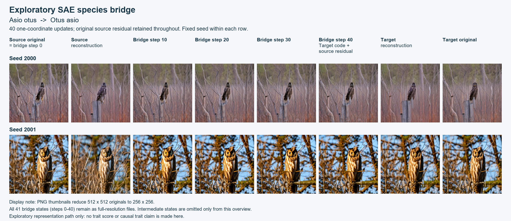

# Owl bridge: *Asio otus* → *Otus asio*

October 23, 2026. Task 2.2 on the stable 362,460-species SAE. The Long-eared Owl's closest support neighbour is *Otus asio* (Eastern Screech-Owl, listed under its older genus name). The saved plan in `../expanded_overlap_v2/bridge_plan.json` swaps the 40 differing SAE coordinates one at a time, keeping the source reconstruction leftover. All 41 states plus original and reconstruction controls were rendered for seeds 2000 and 2001: 90 images, frozen TaxaAdapter (TreeOfLife-1M), model hashes unchanged, peak 68 °C.

Prompt (no species or trait words): `best quality, high quality, photograph of a single bird perched, whole body visible, centered, sharp focus`.

**What changes (by eye):** very little. With seed 2000 the small dark owl on a stump is nearly identical at every step. With seed 2001 the plumage turns warmer and more golden from about step 10. The source and target originals already look almost the same for each seed: the generator draws both species as a similar tufted owl, so this pair offers little visible difference to bridge across.

This contrasts with the ladybird and potoo bridges, where intermediate states produced appearances neither species has. Together, the three bridges show that one-coordinate paths are easy to compute and render, but visible change along them is uneven and seed-dependent.

Files: `images/` (all states), `image_records.json`, `protocol.json`, `run_manifest.json`, `viewer.html`, `bridge_overview.png`, `bridge_overview_audit.json`.
