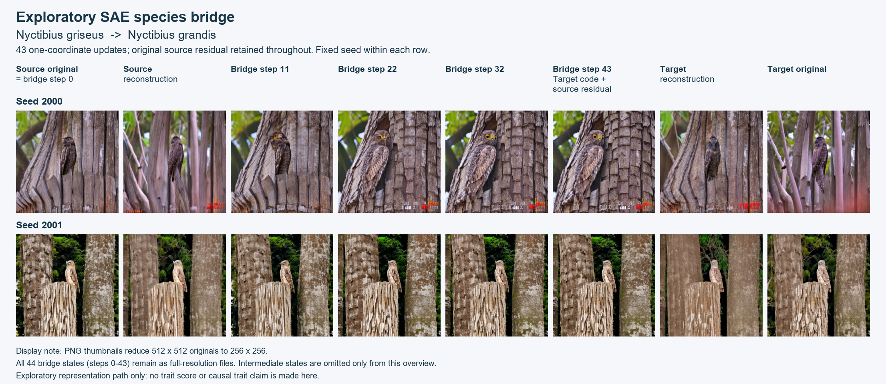

# Potoo bridge: *Nyctibius griseus* → *N. grandis*

October 23, 2026. Task 2.2 on the stable 362,460-species SAE. The Common Potoo's closest support neighbour is the Great Potoo; the saved plan in `../expanded_overlap_v2/bridge_plan.json` swaps the 43 differing SAE coordinates one at a time (largest change first), keeping the source reconstruction leftover. All 44 states plus source/target original and reconstruction controls were rendered for seeds 2000 and 2001: 96 images, frozen TaxaAdapter (TreeOfLife-1M), model hashes unchanged, peak 63 °C.

Prompt (no species or trait words): `best quality, high quality, photograph of a single bird perched, whole body visible, centered, sharp focus`.

**What changes (by eye):**

- **Seed 2000:** from about step 11 the dark, slim potoo becomes a larger, paler, mottled bird with large yellow eyes, which looks owl-like, and stays that way to step 43. Neither endpoint looks like this: the Great Potoo target is rendered dark and slim.
- **Seed 2001:** almost no change; the pale potoo on a stump stays the same.

As with the ladybird bridge, intermediate codes can produce appearances that neither species has, and the effect depends strongly on the image seed. This is a representation path, not a sequence of single-trait changes. The owl-like intermediate echoes the earlier observation that an owl-associated feature also fired for the Common Potoo; this bridge does not test that link.

Files: `images/` (all states), `image_records.json`, `protocol.json`, `run_manifest.json`, `viewer.html` (step-by-step browser), `bridge_overview.png`, `bridge_overview_audit.json`.
