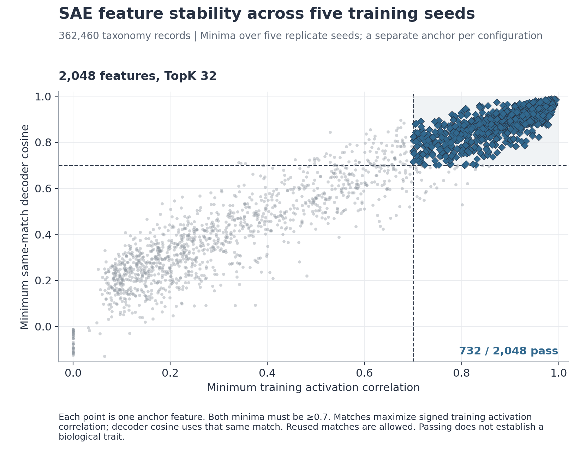
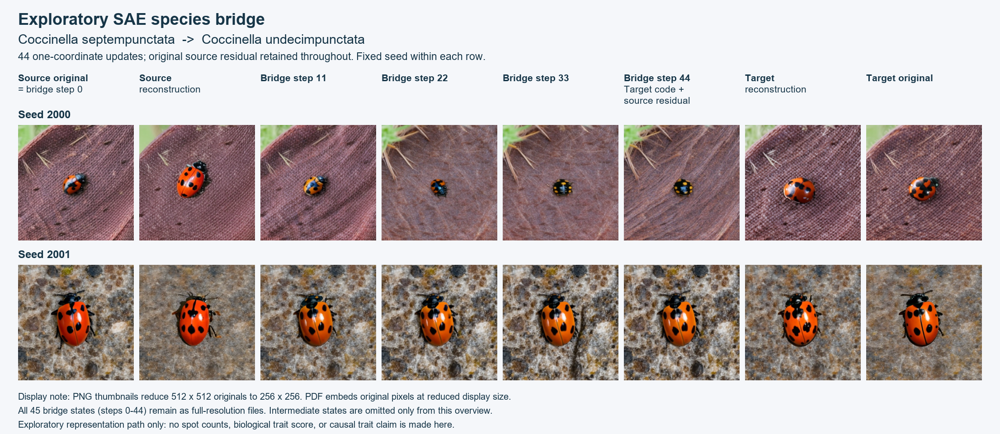

# Expanded BioCLIP trait-discovery results

**October 7 update:** the [completed human review and new tail-trait test](../trait_followup_2026_10_07/REPORT.md) supersede the pending-review status below. This report preserves the October 4 results and decisions: the new human review is complete, and the subsequent tail candidate failed validation.

**Completed October 4, 2026: the expanded SAE has 732 reproducible coordinates, but this study has not established an independently validated biological trait that those coordinates control.** The computational pipeline, data correction, stability study, independent trait tests, full neighbor search and exploratory bridge are complete. Conditional large trait-image experiments were not justified by the results. Human scoring is deferred at the user's request.

Start with the [bridge viewer](../expanded_bridge_images_v2/viewer.html), [bridge overview PDF](../expanded_bridge_images_v2/bridge_overview.pdf), [32-image human review page](../unedited_dorsal_v1/human_review/review.html), or [corpus and embedding report](../../cache/expanded_tol10m_v2/REPORT.md).

The [final package verification](final_verification.json) checks result consistency, runtime hashes, blank human scoring fields, artifact links and representative viewer states. Numerical and image audits remain linked separately below.

## The combined checklist, with final outcomes

| Step | Outcome | Evidence |
|---|---|---|
| 1. Reassess the original 28 ladybird images | Applied the documented strict correction: six low-angle zeros withdrawn; zero accepted original-vector counts out of four. One reconstructed-image count remains an AI candidate. Human review deferred. | [Corrected table](old_ladybird_corrected.csv), [correction provenance](old_ladybird_correction_provenance.json), [original correction](../trait_readiness_v1/SCORING_CORRECTION.md) |
| 2. Generate 32 unedited overhead-view images | Complete, seeds 1000–1031, no SAE and no spot/count instruction in the ordinary prompt. | [Baseline report](../unedited_dorsal_v1/REPORT.md) |
| 3. Check measurement feasibility | Provisional AI: 12 eligible dorsal views, all show spots; 13 ineligible and 7 uncertain. Only 1/32 supports a confident exact count (8). Exact spot count remains unsuitable for scaling. | [AI annotations and limits](../unedited_dorsal_v1/AI_REVIEW_PROVISIONAL.md) |
| 4. Verify and expand species coverage | Exact TreeOfLife-1M membership was not found. Used a clearly labelled, conservative TreeOfLife-10M expansion with 362,460 unique scientific-name strings, including 240,117 Animalia. | [Corpus report](../../cache/expanded_tol10m_v2/REPORT.md) |
| 5. Extract correctly formatted vectors | Complete: 362,460 × 768 raw FP32 BioCLIP 2 vectors, seven taxonomy levels separated by spaces. | [Embedding provenance](../../cache/expanded_tol10m_v2/embedding_provenance.json), [species CSV](../../cache/expanded_tol10m_v2/data/species.csv), [vectors](../../cache/expanded_tol10m_v2/data/embeddings_raw.npy) |
| 6. Train the expanded SAE | Complete: 2,048 features, TopK 32; anchor seed 20260929 plus seeds 1–5; train-only centering/RMS and whole-genus splits. | [Training protocol](../expanded_stability_w2048_k32_v2/protocol.json), [results](../expanded_stability_w2048_k32_v2/summary.json) |
| 7. Repeat the unchanged stability test | **732/2,048 pass** both activation correlation and same-match decoder cosine ≥0.7 in every replicate. Independent CPU audit passed. | [All features](../expanded_stability_w2048_k32_v2/feature_stability.csv), [audit](../expanded_stability_w2048_k32_v2/independent_cpu_audit.json) |
| 8. Run a bounded capacity sweep if needed | Not triggered: the primary configuration passed. No thresholds were relaxed. | [Selection decision](selected_sae.json) |
| 9. Test independent biological labels | Completed AVONET beak-shape benchmark and a single SAE-feature association test. Both prespecified confirmation gates failed. | [Trait report](../trait_benchmark_v1/REPORT.md), [candidate result](../trait_benchmark_v1/sae_candidate_w2048_k32_v2/summary.json) |
| 10. Run a small controlled trait pilot | Not launched: the independently labelled candidate failed validation. A frozen edit planner, controls and image protocol are prepared. | [Conditional decisions](conditional_decisions.json), [prospective image rules](beak_image_protocol.json) |
| 11. Scale a successful pilot and replicate | Not launched: no qualifying trait pilot. More image seeds would not repair failed feature validation or an unmeasurable endpoint. | [Conditional decisions](conditional_decisions.json) |
| 12. Find overlapping species and bridge them | Complete top-10 exact support neighbors for every record: 3,624,600 directed relationships. Three numerical bridge plans; all 44 ladybird coordinate changes rendered across two seeds, with endpoint controls: 98 images. | [Neighbor summary](../expanded_overlap_v2/summary.json), [selected neighbors](../expanded_overlap_v2/selected_neighbors.csv), [bridge viewer](../expanded_bridge_images_v2/viewer.html) |
| 13. Package the results | Reports, checkpoints, sparse arrays, source audits, protocols, figures, image hashes, scoring files and reproducible scripts are saved locally. Earlier negative and preliminary results remain available. | This report and linked artifacts |

## What improved, and what did not



The final corpus has 289,829 training, 36,065 validation and 36,566 test records. All original 5,388 pilot rows and their genus assignments remain intact. The six fits took 831.9 seconds in total. Anchor test reconstruction cosine is 0.90788 and explained variation relative to the expanded training mean is 66.31%. These describe reconstruction, not biological interpretability.

An additional **post hoc descriptive comparison** used exactly the same original 593 test vectors and the same original training-mean denominator for both anchors. Mean cosine increased from 0.87118 to 0.90723, and explained variation from 54.14% to 66.28%. None of those test genus groups entered expanded training. This comparison selected no model or feature; corpus size and kingdom composition still changed together. See the [common-test comparison](../expanded_stability_w2048_k32_v2/common_pilot_test_comparison.json).

The stable-feature count is an anchored matching result, not a count of independent biological concepts. Matches can be reused; all collisions are reported. The [figure source tables and PDFs](figures/STABILITY_FIGURES.md) and [all matched pairs](../expanded_stability_w2048_k32_v2/all_feature_matches.csv) are available for inspection.

## Independent trait evidence

The endpoint was the natural log of AVONET species-mean beak length from the nostril divided by depth at the nostril. Of 8,677 conservatively selected measured species, 8,187 matched the corpus. The held-out test has 774 species from 197 genera.

| Model | Test RMSE | Test R² |
|---|---:|---:|
| Ridge prediction from raw BioCLIP vectors | 0.27179 | 0.65591 |
| Family/order taxonomy baseline | 0.26095 | 0.68279 |

Embedding improvement over taxonomy is −0.01083, with a 95% genus-bootstrap interval of [−0.05664, 0.03918]. The vectors predict beak shape relative to a global mean, but added predictive information beyond this taxonomy control was not established.

Among the 732 stable features, 188 met the prespecified training-support requirements. Training selected **feature 506**, active in 184 labelled training species from 52 genera and 18 families. Its within-family training correlation was −0.15027. Validation correlation was −0.03064, with a 95% interval of [−0.07380, 0.02858]. Only 14 validation species in four genera activated it; 1,904/2,000 bootstrap resamples were defined. The interval crossed zero, so confirmation failed. No replacement feature was chosen after examining validation.

The beak benchmark is separate from ladybird spot scoring. Neither establishes causal trait control. Human annotations remain blank, and the two older AI passes are not independent human raters. In the new 32-image screening, missing exact counts are **NA, never zero**; zero confidently scored seven-spot images does not imply a zero seven-spot generation rate.

## Species overlap and the generated bridge



Binary overlap counts shared positive SAE coordinates; ties use saved row order, with self excluded. All results are stored compactly in [neighbor indices](../expanded_overlap_v2/neighbor_indices.npy), [shared counts](../expanded_overlap_v2/shared_active.npy) and [active counts](../expanded_overlap_v2/active_counts.npy). An independent CPU postings implementation exactly reproduced 128 selected queries. Mean closest overlap is 17.49 out of 32; 81.72% of closest records share kingdom and genus. These are representation statistics, not proof of shared anatomical traits.

| Source | Closest support neighbor | One-coordinate replacements |
|---|---|---:|
| Coccinella septempunctata | Coccinella undecimpunctata | 44 |
| Nyctibius griseus | Nyctibius grandis | 43 |
| Asio otus | Otus asio | 40 |

All three [numerical paths](../expanded_overlap_v2/bridge_plan.json) are saved. The ladybird path was rendered at every state for image seeds 2000 and 2001. Its 98 saved images include source/target raw and reconstructed controls. The two source-original/step-0 pairs are byte-identical, as expected; these duplicates are controls, not independent replications. The [image audit](../expanded_bridge_images_v2/bridge_overview_audit.json) verifies all 98 hashes and dimensions.

Each step uses `x_source + D(z_step) − D(z_source)`, replacing one coordinate and retaining the source reconstruction residual without applying TopK again. The final code equals the target code, but its raw embedding generally differs from the raw target because their reconstruction residuals differ. Both target controls are shown. Ordinary prompting requests an overhead adult beetle without specifying spots or their number. No exact counts or biological causality are inferred from the bridge.

The [prior-lead reassessment](prior_leads_reassessment.csv) finds 17 stable active coordinates in the ladybird, 13 in the common potoo, 15 in the northern potoo and 17 in the long-eared owl. These are new feature identities; old features 729 and 1969 were not transferred or relabelled.

## Data correction and reproducibility

The first expanded corpus contained cross-kingdom ambiguous binomials. A deeper audit identified 367 affected names, including 128 crossing splits. Training was deliberately stopped during its third replicate. That [preliminary run](../expanded_stability_w2048_k32_v1/SUPERSEDED.json) and its inputs are preserved. A separate v2 corpus removes 732 ambiguous records, retaining two known pilot lineages, and the full six-fit study was restarted. This was a data-quality correction, not a hardware failure. All final analysis uses v2.

The original trait-test result had already been seen before that correction. The reanalysis retained exactly the same 8,187 eligible birds and vector values; its predictions are byte-identical. The report discloses that sequence rather than treating v2 as a historically untouched test. Exclusions were based on taxonomy conflicts, not trait performance.

The exact TaxaAdapter TreeOfLife-1M training manifest remains unavailable in the bounded official-release search. This broader corpus is not a synonym-resolved accepted-species census; remaining synonyms and source mislabels can weaken biological genus holdouts. SAE holdout also does not imply absence from BioCLIP pretraining. See [method correspondence and differences from both papers](METHOD_SCOPE.md), [source provenance](../../cache/expanded_tol10m_v2/REPORT.md), the [original protocol](protocol.json), and the [data-quality amendment](protocol_amendment_v2.json).

All image-generation model states matched the fresh unedited baseline and remained unchanged. Training stayed at or below 48°C with at least 21,750 MiB free VRAM; bridge generation stayed at or below 66°C with at least 22,254 MiB free. No OOM, CUDA failure or hardware guard occurred.

## Use the saved results

The anchor checkpoint and compressed sparse vectors are in `../expanded_stability_w2048_k32_v2/seed_20260929/`: `sae.pt`, `code_indices.npy`, `code_values.npy`, and training-only `features.json`. Each row represents a 2,048-dimensional vector with at most 32 positive entries. Other seed folders preserve independently trained models and their feature matches. Large arrays and checkpoints are local artifacts excluded from Git; a fresh clone requires regeneration or copying those files.

From the repository root in PowerShell, query any retained species without training:

```powershell
& '.\.venv-taxaadapter\Scripts\python.exe' 'task5_bioclip_sae\generation\analyze_expanded_overlap.py' --query 'Coccinella septempunctata'
```

For a new numerical edit plan, [prepare_expanded_edit.py](../../prepare_expanded_edit.py) accepts a completed study, species, anchor feature, optional replicate seed and new output directory. It verifies hashes and prepares original/reconstruction/removal/half/double/other-active/random-control vectors. [render_expanded_bridge.py](../../render_expanded_bridge.py) injects saved plans into frozen TaxaAdapter; [run_expanded_sae_study.py](../../run_expanded_sae_study.py) uses separate `--plan-only` and `--execute` commands and refuses output overwrites. The standalone feature-edit helper was code-reviewed and syntax-checked; the executed image experiment here is the audited bridge, not a completed trait pilot.

The next human task is the [32-image review](../unedited_dorsal_v1/human_review/review.html), with its [blank scoring CSV](../unedited_dorsal_v1/human_review/scoring.csv). A biological discovery claim still needs a reproducible independently supported trait candidate and valid controlled image measurements. The present negative gates should remain visible in any presentation of these results.
