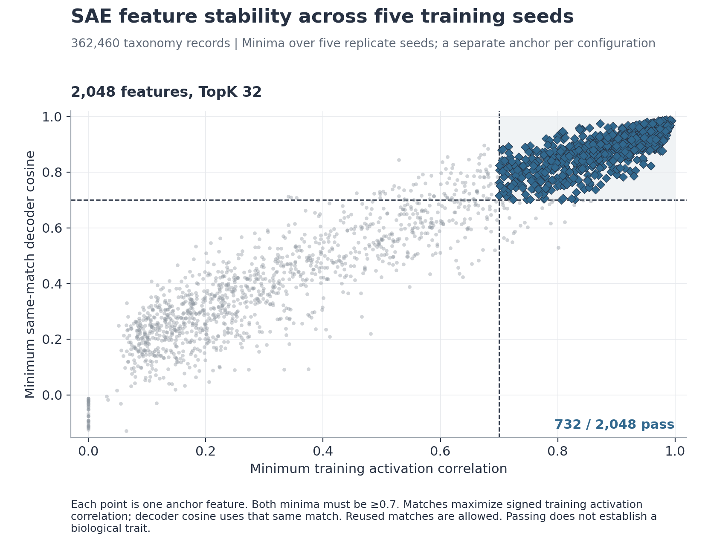
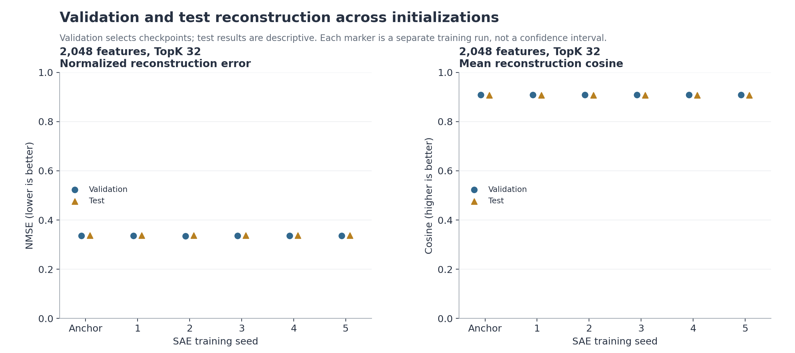

# Expanded SAE stability figures

The figures use 362,460 taxonomy records and the unchanged two-part 0.7 gate across all five replicate seeds.

| Configuration | Passing features |
|---|---:|
| 2,048 features, TopK 32 | 732 / 2,048 |

[Feature point data](feature_stability_points.csv) · [Reconstruction values](reconstruction_metrics.csv) · [Provenance](figure_provenance.json)

Every point in the feature-stability figure is a matched anchor coordinate. Passing requires both the training activation correlation and the decoder cosine for that same match to remain at least 0.7 in every replicate. Validation correlations are retained in the point table as confirmation diagnostics. Reused matches are allowed.

Reconstruction panels use a fixed 0–1 scale. Individual seed markers do not represent statistical uncertainty. No biological trait or image-generation effect is established by these figures.
