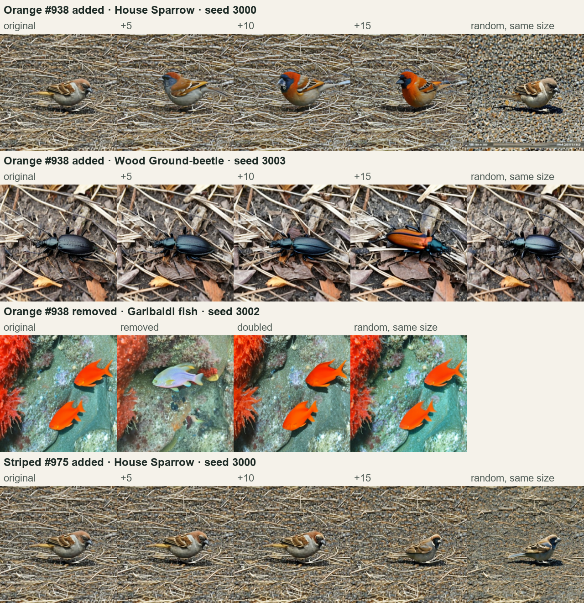

# Feature gallery v1: "orange" and "striped"

October 23, 2026. Task 2.1 on the stable expanded SAE: turn one feature on or off, rebuild the 768-dimensional vector, and generate images with frozen TaxaAdapter (TreeOfLife-1M checkpoint). No training. 208 images, 4 image seeds (3000–3003), 50 DDIM steps, guidance 6, generic prompt. Generator weights were unchanged (hashes checked against the unedited calibration run). Script: [`run_feature_gallery.py`](../../run_feature_gallery.py).

The summary figure shows clear examples and was picked after viewing. Counts across **all** seeds are below; per-species sheets are `sheet_*.png`.

## Features tested

Both features pass the 5-seed stability gate of the expanded SAE (activation correlation ≥ 0.86, decoder cosine ≥ 0.90).

| Feature | Top species share the Latin word | Species where active | Also fires for |
|---|---|---|---|
| **#938** | *aurantiaca, aurantium, naranja* ("orange") | 70,955 | Monarch butterfly (5.95), Red-bellied Woodpecker (3.40), garibaldi fish: orange animals whose names don't say orange |
| **#975** | *vittata, trivittata* ("striped") | 1,979 | only *vittata*-named species |

## Design

- **Add** (feature off in the species): House Sparrow, Eastern Gray Squirrel, Great Egret, Wood Ground-beetle. Activation set to 5, 10, 15 (top species sit near 12).
- **Remove / double** (feature on): garibaldi and Monarch for #938; Banded Tiger Moth and *Cassida vittata* for #975.
- **Control:** a random direction of the same size as the largest edit, orthogonal to the feature direction.
- Edits keep the SAE reconstruction leftover: `edited = raw + Δactivation × scale × decoder[:, f]`.

## Results

Visible change on the animal, judged by eye (not blinded), out of 4 seeds:

| Edit | Result | Random control |
|---|---|---|
| Orange added, +15, sparrow | 4/4 orange plumage (1 seed became a flock of orange birds) | 0/4 |
| Orange added, +15, egret | 3/4 orange legs, bill or neck | 0/4 |
| Orange added, +15, squirrel | 2/4 orange (other 2: animal lost or scene replaced) | 0/4 |
| Orange added, +15, ground-beetle | 2/4 orange wing covers (+1 partial at +10) | 0/4 |
| **Orange removed, garibaldi** | **4/4 lose their orange** (yellow, white, dark or dull red) | 0/4 |
| Orange removed, Monarch | 1–2/4 paler; Monarch stays mostly orange | 0/4 |
| Striped added, all 4 species | 0/16 — almost no change, less than the random control | — |
| Striped removed, *Cassida vittata* | 2–3/4 fainter stripes | 0/4 |
| Striped removed / doubled, tiger moth | mixed; one doubled seed gains bolder stripes | — |

Whole-image orange-pixel fraction (crude: counts background too), mean over add species × seeds: original 2.0%, +5 2.2%, +10 2.7%, +15 3.5%, random 1.8%. Removal: garibaldi 7.6% → 5.5%, Monarch 10.6% → 6.2%; doubling raises both.

## Interpretation

- **#938 behaves like an "orange colour" control.** Turning it up adds orange to unrelated animals with a dose response; turning it down removes orange from the garibaldi; a random edit of the same size does neither. This is the first SAE dimension in this project that changes one visible trait in generated images.
- **#975 does not behave like a "striped" control.** The generator largely ignores this direction, consistent with it encoding the Latin word *vittata* rather than learned appearance.
- The difference matches the activation patterns: #938 also fires for orange species whose names don't say orange (Monarch), so BioCLIP links it to appearance; #975 fires only for *vittata* names.

## Limitations

- Single SAE checkpoint (the feature itself recurs across 5 SAE seeds), 4 image seeds, one generic prompt.
- Judgments are mine, by eye and unblinded; the orange-pixel measure includes background.
- At +15 orange also leaks into the scene (bowls, water, flames) and can break the composition, so the edit is not perfectly specific to the animal.
- Removing orange from the Monarch barely works: orange appears to be part of the Monarch's identity, not only this feature.
- The trait comes partly from name meaning (*aurantiaca*), so this shows the vector encodes colour, not that BioCLIP discovered colour purely from images.

## Files

- `protocol.json`: features, species, strengths, seeds, all 52 vector records with edit sizes.
- `vectors.npy`: the 52 edited 768-dimensional vectors. `image_records.json`: every image, hash and orange fraction.
- `sheet_*.png`: one sheet per feature × species (rows = seeds). `summary.png`: selected examples.
- `run_manifest.json`, `hardware.jsonl`: run status, model hashes, GPU temperature (max 71 °C).
