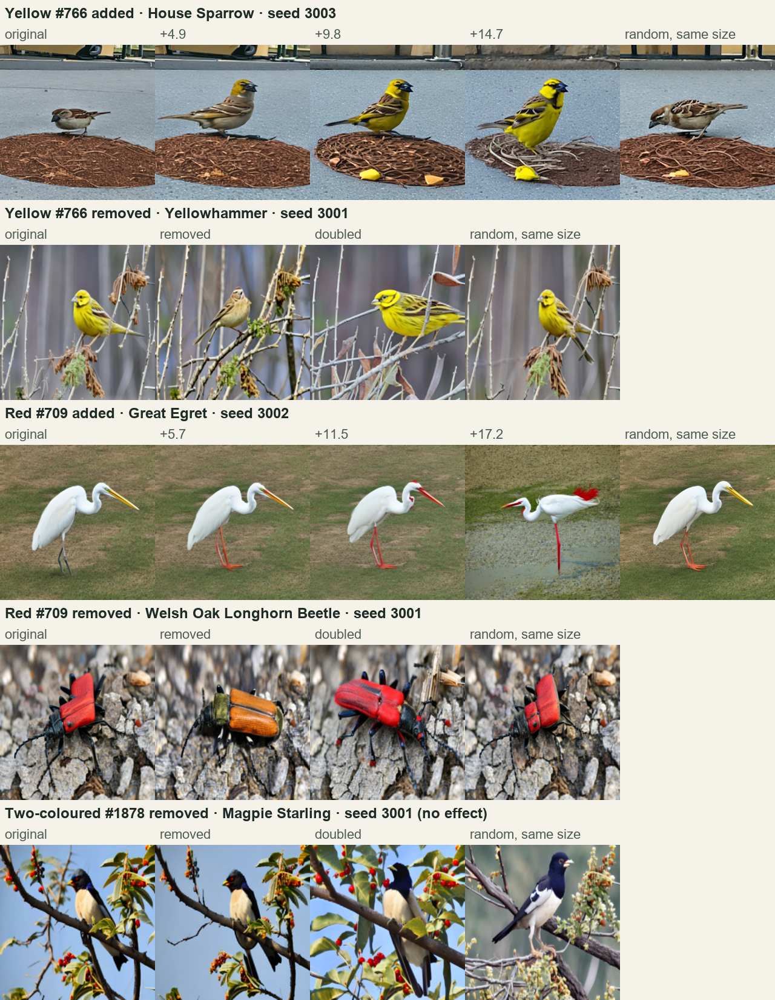

# Feature gallery v2: red, yellow, blue-grey, two-coloured, slender

October 23, 2026. Continues [feature gallery v1](../feature_gallery_v1/REPORT.md) (orange, striped) with the remaining stable features whose top species share an appearance word in their Latin names. Same method: set one SAE feature, rebuild the 768-dimensional vector keeping the reconstruction leftover, generate with frozen TaxaAdapter (TreeOfLife-1M). No training. 496 images, seeds 3000–3003, generic prompt; generator hashes unchanged; peak GPU 72 °C.

Run: `run_feature_gallery.py --config configs/feature_gallery_v2.json --out-dir experiments/feature_gallery_v2`. The refactored script reproduces the v1 vectors exactly.

The summary shows clear examples picked after viewing, plus one failure. Every species × seed is in `sheet_*.png`.

## How features were found

Among the 732 features that pass the 5-seed stability gate, a search for colour, pattern and shape stems (*rubr-, flav-, glauc-, bicol-, gracil-, …*) in the top-8 species' Latin epithets found 7 features (v1 + v2). Black and white candidates exist but failed the stability gate, so they were not tested.

Add strengths are 0.4×, 0.8× and 1.2× each feature's top training activation. Removal uses two species that strongly have the feature.

## Results across all seven features

Judged by eye, unblinded, out of 4 image seeds; "random" is a same-size random direction.

| Feature | Added to plain species | Removed from species that have it | Verdict |
|---|---|---|---|
| **Orange #938** (v1) | sparrow 4/4, egret 3/4, squirrel 2/4, beetle 2/4; random 0 | garibaldi 4/4 lose orange; Monarch 1–2/4 | **controls colour** |
| **Red #709** | sparrow 3/4 red (4th: a red object replaced the bird); egret red head/bill/neck 4/4 (leg colour also shifts under random) | red longhorn beetle 4/4 turn orange-brown; random 0/4 | **controls colour** |
| **Yellow #766** | sparrow 4/4 yellow; ground-beetle 3/4 gold; random 0 | Yellowhammer 4/4 become brown; random 0/4 | **controls colour** |
| Striped #975 (v1) | 0/16 | beet beetle 2–3/4 fainter stripes | no clear effect |
| Two-coloured #1878 | 0/8 viewed (sparrow, squirrel) | Magpie Starling 0/4 | no effect |
| Slender #1372 | squirrel 0/4 | slender wrasse 0/4 | no effect |
| Blue-grey #689 | egret 0/4 | no effect by colour measure | no effect |

Whole-image colour fraction (crude; includes background), mean over the 4 add species × 4 seeds:

| | original | low | mid | high | random |
|---|---:|---:|---:|---:|---:|
| red pixels, red #709 | 0.9% | 0.8% | 2.9% | 3.5% | 0.8% |
| yellow pixels, yellow #766 | 0.8% | 1.2% | 2.8% | 4.8% | 0.2% |
| blue pixels, blue-grey #689 | 0.2% | 0.2% | 0.1% | 0.1% | 0.6% |

Removal: red longhorn beetle 4.2% → 0.0% red, red-banded leafhopper 1.3% → 0.0%; Yellowhammer 4.7% → 0.7% yellow, grass-yellow butterfly 2.4% → 0.0%. Doubling raises each.

## Why three features work and four don't

Among each feature's 200 most-activated animal species, how many have **no** matching word anywhere in their name:

| Feature | No matching word | Examples | What it encodes |
|---|---:|---|---|
| Orange #938 | 181/200 | garibaldi, Baltimore Oriole | orange animals |
| Red #709 | 95/200 | Claret Pondhawk, Rustic Sailor Beetle | red animals |
| Yellow #766 | 134/200 | Common Grass Yellow, Andaman Butterflyfish | yellow animals |
| Slender #1372 | 148/200 | *granti, grabhami, grandipes* | names starting "gr" (spelling) |
| Blue-grey #689 | 183/200 | *plumulosus, planatus, placidus* | names starting "pl" (spelling) |
| Two-coloured #1878 | 10/200 | *discolor, unicolor* | the word "color" |
| Striped #975 | 61/200 | mixed | mostly the word *vittata* |

The working features fire for animals that **look** that colour even when the name never says it, so BioCLIP has tied them to appearance learned from images, and TaxaAdapter follows them. The failing features track spelling or a word, which the generator ignores.

## Limitations

- One SAE checkpoint (each feature recurs across 5 SAE seeds), 4 image seeds, one generic prompt, unblinded visual judgments by one reviewer.
- Colour edits are not animal-specific: at high strength the colour leaks into objects or scenes, and some compositions break (flocks, objects replacing the animal).
- The colour measure counts the background.
- Colour is a simple trait. This shows the 768-dimensional vector contains controllable colour directions; it does not show finer traits (spot count, beak shape) are similarly controllable.

## Files

- `../../configs/feature_gallery_v2.json`: features, labels, strengths and species, fixed before generation.
- `protocol.json`, `vectors.npy` (124 vectors), `image_records.json` (496 images with hashes and colour fractions).
- `sheet_add_<feature>_<species>.png`, `sheet_remove_<feature>_<species>.png`: all seeds. `summary.png`: selected examples.
- `run_manifest.json`, `hardware.jsonl`.
