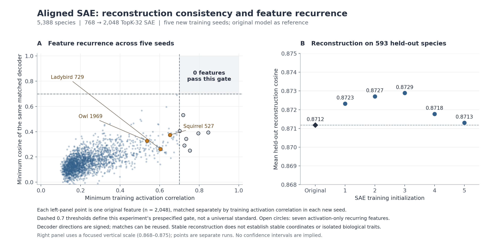

# BioCLIP / TaxaAdapter follow-up — October 4, 2026

**The aligned SAE stability experiment is complete: none of the 2,048 original features passed the prespecified recurrence criterion.** The planned larger image experiment therefore has no qualifying feature. This is a negative result for this SAE configuration and matching rule, not evidence that BioCLIP contains no biological information.

Training was authorized for this continuation. Five new SAE initializations and one original-seed reproduction were fitted using the existing 5,388 embeddings. BioCLIP and TaxaAdapter remained unchanged. No out-of-memory or other hardware error occurred.

## What was completed

| Work item | Outcome | Evidence |
|---|---|---|
| Aligned SAE seed stability | Five new seeds plus exact original-seed reproduction; 0/2,048 features pass the combined gate | [Stability report](../aligned_stability_v1/REPORT.md) |
| Independent numerical audit | Original artifacts preserved; matches, checkpoint selection, split separation and gate decisions verified on CPU | [Stability audit](../aligned_stability_v1/independent_audit.json) |
| Animal-focused measurement readiness | Two blinded AI scoring passes on all 28 existing ladybird images; native animal crops saved | [Readiness report](../trait_readiness_v1/REPORT.md) |
| Larger paired-seed experiment | Prospective 32-seed protocol prepared; generation not launched because no feature passed the stability prerequisite | [Follow-up protocol](../planning_v2/trait_protocol_recommendation.txt) |
| Ladybird and potoo follow-up | Species availability and original activations checked; neither associated coordinate passed the stability gate | [Candidate results](../aligned_stability_v1/selected_feature_matches.csv) |

## Stable reconstruction does not establish a stable edit direction

Every new run used the original 768 → 2,048 TopK-32 architecture, fixed whole-genus splits, training-only centering/RMS, Adam learning rate 0.001, batch size 256, and unchanged validation checkpoint selection. The original seed reproduced all saved state tensors and sparse codes exactly. The five new runs reached mean test reconstruction cosine 0.8713–0.8729, close to the original 0.8712.

Before training, the protocol required both training activation correlation ≥0.7 and cosine of the same matched decoder direction ≥0.7 in **every** new seed. These are this experiment's conservative thresholds, not universal definitions of biological meaning. Matching uses signed correlations on training species; validation correlations are descriptive because validation species also selected checkpoint epochs. Test species did not select features or checkpoints.

| Original candidate | Minimum activation correlation | Minimum matched decoder cosine | Passes both thresholds in every new run? |
|---|---:|---:|---|
| Ladybird feature 729 | 0.6035 | 0.2627 | No |
| Owl / potoo lead 1969 | 0.5357 | 0.3276 | No |
| Squirrel feature 527 | 0.6525 | 0.3743 | No |

Seven other features pass activation recurrence alone. None activates for the original ladybird or either available potoo species, and none passes the direction criterion. A separate diagnostic allowing the best decoder match regardless of activation also finds zero features reaching cosine 0.7 in all five runs. Thus the result is not explained solely by the activation-based matching rule or reused matches.



The existing image changes remain valid demonstrations of editing one fitted representation. They do not yet identify reproducible biological trait coordinates. Increasing image-generation seeds would improve precision within that fitted representation but would not repair its cross-run direction instability.

## Counting the animal's visible markings

**Correction after user review:** Six of the seven initially agreed counts came from highly similar, low-angle seed-42 images. Their eligibility is withdrawn under the original dorsal-view rule; the original-vector pilot now has no accepted count in four seeds. The remaining AI-agreed seven-patch image is reconstruction seed 45. The initial statistics below describe the archived annotation passes only. See [the scoring correction](../trait_readiness_v1/SCORING_CORRECTION.md), which recommends a simple 32-seed unedited dorsal-view pilot and human review before any large intervention batch.

The 28 ladybird images from the earlier four-seed experiment were shuffled and relabeled without condition names. Two AI annotation passes used a fixed visibility/spot-count rule. Each marked 8/28 images scorable; they agreed on scorability for 26/28 images. Seven images were accepted by both, with exact agreement on their visible-patch counts. Two images remain disputed. The rules reject unclear views, inadequate size, opposite-polarity coloration and ambiguous patch boundaries; missing counts remain missing.

These annotations are exploratory AI assessments, **not expert human ground truth**. The images predate this scoring rule, and the reviewers share a model family. Agreement therefore does not establish biological correctness. Initially one original-condition image had a jointly accepted count; that acceptance is now withdrawn as described above. No random-control image had an accepted count. A valid feature-versus-random spot-count comparison cannot be estimated from this pilot.

All 28 animal crops preserve native pixels, use the union of the reviewers' approximate boxes with 5% padding, and retain some background. Cropping cannot recover hidden detail. The [crop sheet](../trait_readiness_v1/animal_crops.png), [annotations](../trait_readiness_v1/unblinded_annotations.csv), and [locked rules](../trait_readiness_v1/annotation_protocol.json) make this limitation reviewable.

## Why the larger image experiment was not run

The agreed sequence was to establish recurring features before expanding image interventions. No feature qualified, so no new 32-seed intervention batch or potoo intervention was launched. The thresholds were not lowered after inspecting the results, and an unrelated feature was not relabeled as a ladybird or potoo trait.

The prepared protocol specifies fresh paired image seeds 1000–1031, residual-preserving edits, original/reconstruction/dose/control conditions, predefined species replication, animal visibility rules, blinded annotations, paired effect estimates and confidence intervals. It remains a **proposed experiment**, not an executed result. Human annotation and a reproducible candidate are still required before claiming independent trait validation.

The next scientific problem is representation reproducibility. Candidate follow-up designs include a larger verified species corpus, a separately declared SAE capacity/regularization study, or testing recurrence of feature groups. This run does not establish which remedy will succeed. A new design should be fixed before testing its results, and should retain the same separation between representation quality and biological validation.

## Hardware and provenance

Six fits and their numerical analysis took 26.9 seconds on the RTX 5090. Before/after-run hardware samples reached 40°C and 5,025 MiB total GPU memory use; the maximum per-run PyTorch allocation peak was 384.2 MiB. These are sampled/allocated measurements, not continuous whole-device peaks. No hardware error, OOM, fallback or retry occurred. Plotting, annotations and audits were additional CPU/visual work.

Original embeddings, SAE, generator inputs and historical reports were preserved. New SAE checkpoints, sparse codes and training histories are saved in `../aligned_stability_v1/`. Large `.pt` and `.npy` experiment artifacts are locally available and excluded from Git; reports, protocols and inspection tables describe how they were produced.

The current data remain a 5,388-species Animalia pilot. The exact TreeOfLife-1M species manifest, full 200K+ coverage, and independent biological-trait validation are still incomplete. Earlier [188-image results](../existing_sae_v1/REPORT.md) and the [saved-image viewer](../existing_sae_v1/viewer.html) remain available.

## Reproduce or inspect

From the repository root, inspect the replication wrapper without training:

```powershell
& './.venv-taxaadapter/Scripts/python.exe' 'task5_bioclip_sae/generation/reproduce_aligned_stability.py' --help
```

To train another identical seed study, use that wrapper with `--out-dir task5_bioclip_sae/generation/experiments/aligned_stability_replication_v1`. It calls the unchanged recorded training script, refuses existing output directories, and retains its hardware stop checks. The wrapper help and overwrite guard were checked; a duplicate training run was not launched.

The [stability protocol](../aligned_stability_v1/protocol.json) records the exact settings and input hashes. The [readiness summary](../trait_readiness_v1/summary.json) records annotation, key, protocol and script hashes. `prepare_trait_readiness.py` reproduces blinded copies and sheets from the existing saved images; `summarize_trait_readiness.py` requires both locked annotation files and performs no model inference or fitting. Visual annotations themselves are recorded observations, not automatically regenerated by those scripts.
