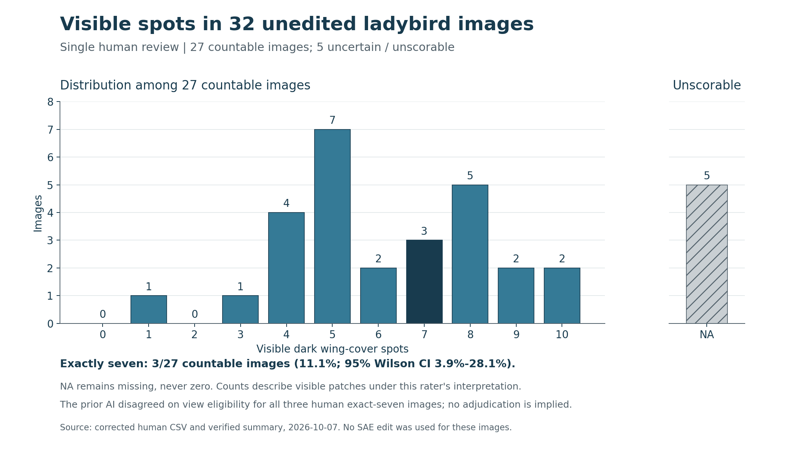
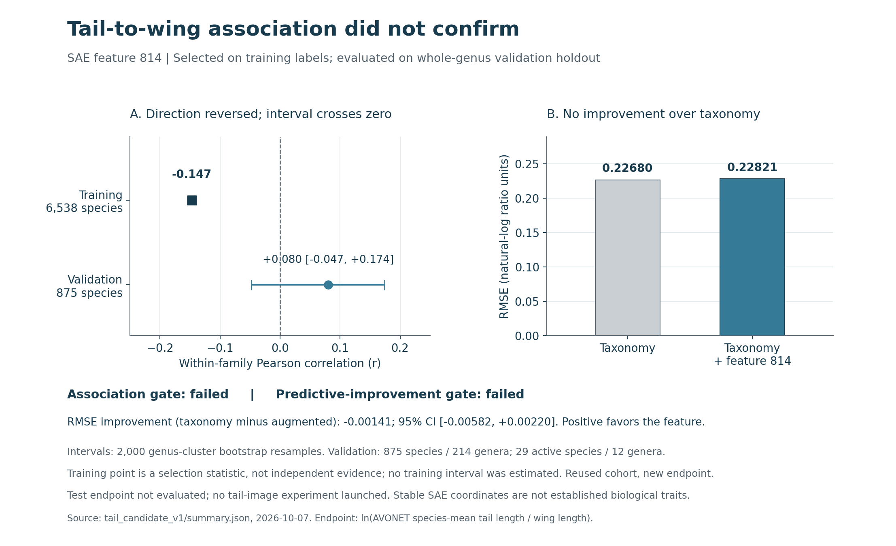

# Human review and independent trait follow-up

October 7, 2026. **The 32-image human review is complete. The new tail-to-wing trait test also completed, but its selected SAE feature failed validation. Biological trait control remains unestablished.** No SAE, BioCLIP or TaxaAdapter weights were changed in this follow-up, and no new animal images were generated.

The [saved decisions](followup_decisions.json) distinguish completed work from untriggered experiments; the [package verification](package_verification.json) checks the final artifacts and links.

## Completed work and decisions

| Work | Result | Consequence |
|---|---|---|
| Save completed human review | Original browser export preserved; three visibility fields corrected only after the user's explicit clarification | Human evidence now replaces the previous pending-review status for these 32 images |
| Analyze measurement feasibility | Human: 27/32 eligible and countable; 5 NA; 3/27 scorable images counted seven | A small exploratory counting study is feasible for this rater, with substantial unresolved human–AI eligibility disagreement |
| Select a new independent label | AVONET log species-mean tail length / wing length; 8,187 exact matched birds | One new endpoint selected on source availability and visibility considerations before examining associations |
| Select one stable SAE candidate | Feature 814 selected from 188 eligible training candidates among the existing 732 stable features | Selection saved before validation endpoint calculation |
| Confirm on held-out genera | Validation correlation changed sign and its interval crossed zero; taxonomy-plus-feature prediction did not improve | Candidate rejected under the locked rules; no replacement feature selected |
| Test and image experiments | Not run because validation failed | Test endpoint values were not computed/analyzed; calibration, controlled image pilot and larger replication remain untriggered |

The [October 4 expanded report](../expanded_followup_2026_10_04/REPORT.md) remains the source for 362,460 taxonomy vectors, six SAE fits, 732 stable coordinates, complete support-neighbor retrieval and the 98-image exploratory ladybird bridge. Those artifacts are unchanged.

## What the human review establishes

The [human report](../human_review_2026_10_07/REPORT.md) and [corrected score table](../human_review_2026_10_07/human_scores_corrected.csv) contain the complete evidence. The original export remains unchanged. D002, D008 and D027 originally combined uncertain visible-spots responses with counts of five; the user confirmed that spots are visible and the count is five in each. Only those three visibility entries changed in the derived table. This clarification was applied to the saved analysis CSV; the original browser export is retained as provenance.

| Human outcome | Estimate | 95% Wilson interval |
|---|---:|---:|
| Eligible and exactly countable | 27/32 = 84.4% | 68.2%–93.1% |
| Visible spots among eligible images | 27/27 = 100% | 87.5%–100% |
| Exactly seven among scorable images | 3/27 = 11.1% | 3.9%–28.1% |
| Scorable-and-seven among all generated images | 3/32 = 9.4% | 3.2%–24.2% |

The last row is a joint observed outcome; the five unscorable images are not counted as biologically non-seven. Counts span 1–10, with mean 6.15 and median 6. Exactly-seven IDs are D005, D010 and D026. All five uncertain counts remain NA, never zero.



The [human figure PDF](../human_review_2026_10_07/figures/human_spot_count_distribution.pdf) is available for export.

This is a single human rater with unspecified expertise. No numeric pass threshold was locked before this review, so the result is descriptive, not a retrospectively passed confirmation test. The confidence intervals describe variation over image seeds at fixed settings and rater; they exclude annotation error and cross-species uncertainty.

Human and provisional AI eligibility descriptors agree on only 12/32 images. All three human exact-seven images were view-ineligible under the earlier AI review. Only D011 has numeric counts from both raters, both eight. These disagreements are reported separately; AI judgments do not override the human annotations, and one common count does not establish reliable inter-rater counting. The [human verification](../human_review_2026_10_07/verification.json) independently checks counts, intervals and all 32 image hashes.

## The new trait test

The [source/design note](SOURCE_DESIGN_NOTE.md) documents why `ln(Tail.Length / Wing.Length)` was chosen from the independently measured [AVONET version 7 data](https://figshare.com/articles/dataset/16586228/7). It is a ratio of species means, not a specimen-level average ratio, sex-specific label or allometric residual. The original source-quality rules are retained: at least four completely measured specimens, no inferred morphology and positive finite measurements. The existing exact bird join provides 6,538 training, 875 validation and 774 test species in disjoint genera. The exact TaxaAdapter TreeOfLife-1M membership remains unknown.

The [protocol](protocol.json), [execution lock](execution_lock.json) and [runner](run_tail_candidate.py) were saved before any new endpoint association. Only the existing 732 recurrent features were considered. Training eligibility required activity in at least 30 labelled species, 10 genera and three families. Ranking used absolute training Pearson correlation after subtracting each family's mean from both variables, with deterministic feature-ID ties. Exactly one candidate was sealed; validation could not promote a runner-up.

Feature **814** had training support in 225 species, 98 genera and 41 families. Its training within-family correlation was **−0.14671**. Validation support was adequate under the new locked minimum—29 active species, 12 genera and 10 families—but confirmation failed:

| Validation quantity | Result |
|---|---:|
| Species / genera | 875 / 214 |
| Within-family correlation | +0.08032 |
| Correlation 95% genus-bootstrap interval | [−0.04744, +0.17382] |
| Taxonomy-only RMSE | 0.22680 |
| Taxonomy-plus-feature RMSE | 0.22821 |
| RMSE improvement: taxonomy minus augmented | −0.00141 |
| Improvement 95% genus-bootstrap interval | [−0.00582, +0.00220] |

All 2,000 correlation bootstrap resamples were defined. Each resample selected whole genera with replacement and recomputed family centering with multiplicities. The taxonomy models and activation slope were fitted only on training rows, with fixed shrinkage settings and no validation tuning. Positive RMSE improvement would favor the feature; the observed estimate was negative. Both required gates failed.



The [tail figure PDF](figures/tail_validation_evidence.pdf) preserves the negative result and its uncertainty for export.

The [result summary](tail_candidate_v1/summary.json), [all training feature associations](tail_candidate_v1/training_feature_associations.csv), [sealed selection](tail_candidate_v1/training_selection.json), [frozen training predictors](tail_candidate_v1/training_predictors.json) and [validation rows](tail_candidate_v1/validation_values.csv) are inspectable. No test endpoint result or image intervention is claimed. The workbook parser reads raw rows for every partition; the narrower guarantee is that test endpoint values were not computed or analyzed.

## Interpretation and remaining research

The completed human review improves the evidence that visible spots can be counted under these image settings. It does not independently identify a spot-related SAE coordinate or rescue either failed bird-trait candidate. Feature stability, association with measured species traits, and controlled changes in generated anatomy remain separate requirements.

The tail endpoint was chosen after the failed beak result was known. This is sequential follow-up research on a reused cohort and SAE; it is not a historically pristine project-level test. The SAE itself used validation embeddings for checkpoint selection. Genus holdouts and family adjustments also do not constitute full phylogenetic control or prove pretraining novelty.

Even a successful tail association would require a measurement-feasibility experiment: AVONET tail length starts at feather emergence from skin, and wing length at the wrist, landmarks that generated feathers and pose can obscure. A visible silhouette ratio would be a separately defined proxy requiring validation. No such substitution was made to obtain a positive result.

This phase ends at the prespecified failed validation gate. The remaining discovery goal needs a new independently labelled visible-trait study with a declared confirmation plan. Selecting additional winners from this validation set would not establish confirmation. The existing bridge remains useful as an exploratory representation visualization, without a biological trait-control claim.

## Reproduction and verification

The CPU-only run completed normally in about 3.8 seconds after locking inputs. No memory or other hardware error occurred. No GPU computation, SAE retraining, generator update or new image generation was performed.

From the repository root, run the independent audit against the saved result:

```powershell
& '.\.venv-taxaadapter\Scripts\python.exe' 'task5_bioclip_sae\generation\experiments\trait_followup_2026_10_07\audit_tail_results.py'
```

The [independent result audit](tail_candidate_v1/independent_verification.json) passed. It independently parsed source XML for training/validation rows, rebuilt sparse activations, verified all 732 rankings and 188 eligibility decisions, checked the slope against least squares, rebuilt predictions, and reproduced all 2,000 bootstrap draws using weighted genus multiplicities. Numerical discrepancies were below 1e-15. All locked input hashes and the selection hash match; test result files are absent.

The runner's `--plan-only` and `--execute` modes refuse to overwrite an existing execution lock or result directory. Keep the saved result and historical protocols when preparing a separately named future experiment. [Small synthetic checks](synthetic_verification.json) independently compare family-centered slopes against least squares and test taxonomy fallbacks; the result audit separately checks the actual run.
