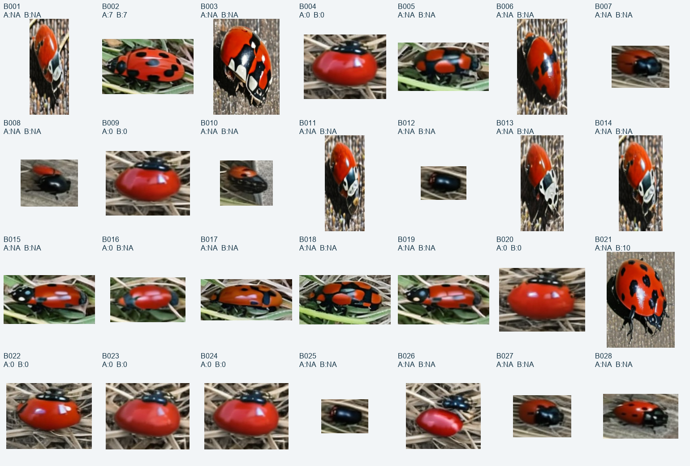

# Ladybird trait-scoring readiness audit

**Scoring correction, October 4:** The initial seven count agreements span only two generation seeds. Six are low-angle seed-42 images whose acceptance is withdrawn under the stated dorsal-view rule. None of the four original-vector images now has an accepted count. The initial statistics below are preserved as historical AI scoring, not validated measurement readiness. See [the correction and revised pilot](SCORING_CORRECTION.md).

**Exploratory measurement audit of 28 existing images; no new generation or training.**

Two blinded AI passes judged 8/28 and 8/28 images scorable. Scorability agreed on 26/28 images. Both accepted 7 images, and exact counts agreed on 7 of those.

These are AI visual annotations, not biological expert ground truth. The comparison exposes uncertainty in the measurement rule and image visibility; it does not validate spot-count control. The 28 images come from the earlier four-seed pilot and were not generated prospectively under this rule.

## Method

Before scoring, the saved images were randomly ordered, given opaque IDs, and separated from condition filenames. Each reviewer used the same locked eligibility and counting instructions. Both annotation files were completed before this script opened the key. Disagreements remain unresolved; no majority or expected biological count was substituted. Missing counts are not zeros.

The endpoint counts separate visible dark patches on recognizable light-colored wing covers. It excludes the head, pronotum, appendages, seam and continuous edge. Side views, small animals, unclear/fused patches and opposite-polarity coloration can make the endpoint unscorable. Both reviewers supplied approximate boxes; crops use their union with 5% padding and retain native pixels.

## Scorability by condition

| Condition | Images | Reviewer A | Reviewer B | Both | Exact count agreement |
|---|---:|---:|---:|---:|---:|
|control_remove_residual|4|1|1|1|1|
|double_residual|4|1|1|1|1|
|half_residual|4|1|1|1|1|
|original|4|1|1|1|1|
|random_direction_control|4|0|0|0|0|
|reconstruction|4|2|3|2|2|
|remove_residual|4|2|1|1|1|

## Animal crops

Numbers are visible-patch counts; NA means unscorable. Cropping reduces the background but cannot restore hidden detail or remove uncertainty about anatomy.

## Decision

No trait-effect estimate or significance claim is made. Four original image seeds cannot satisfy the proposed requirement of 16 scorable paired counts, and the current SAE failed its direction-stability gate. The results support using an explicit dorsal-view prompt and clearer patch/edge examples for a future measurement calibration, before a new confirmatory protocol is locked. Human expert review is still needed for biological validation.

The prospective 32-seed plan is saved in [the follow-up protocol](../planning_v2/trait_protocol_recommendation.txt). The larger generation was not launched because no SAE feature passed the previously fixed stability gate.

## Files

- [Locked annotation rules](annotation_protocol.json)
- [Reviewer A](annotations_reviewer_a.json) and [Reviewer B](annotations_reviewer_b.json)
- [Unblinded annotations](unblinded_annotations.csv) and [numerical summary](summary.json)
- Native crops are in `crops/`; blind sheets and full-resolution blind images remain available.
