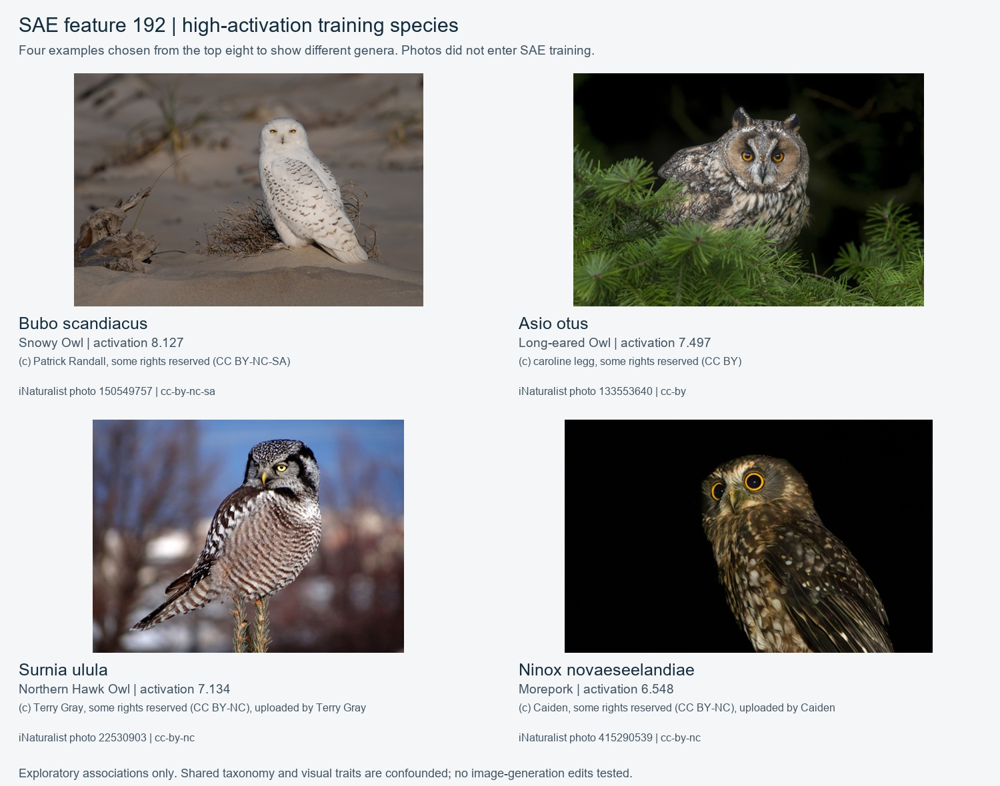
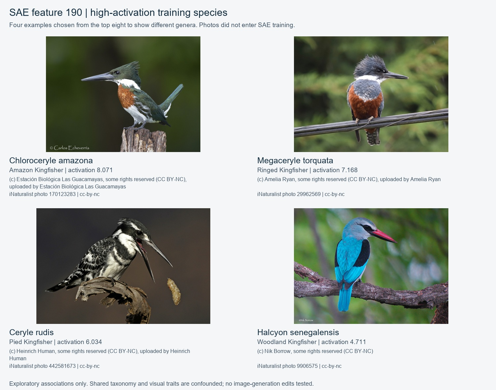
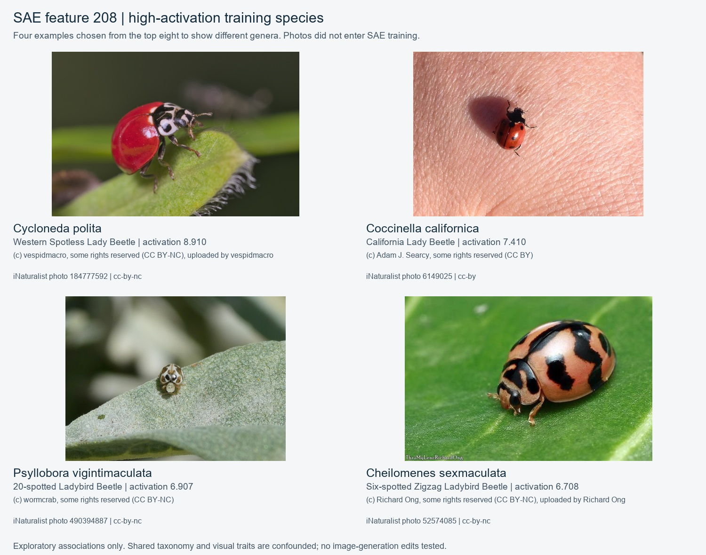
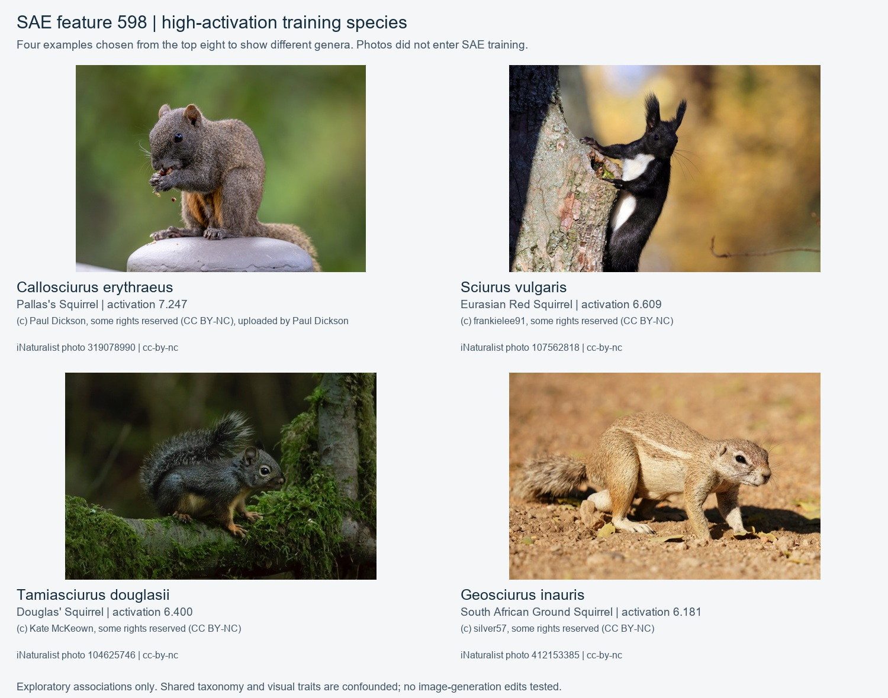
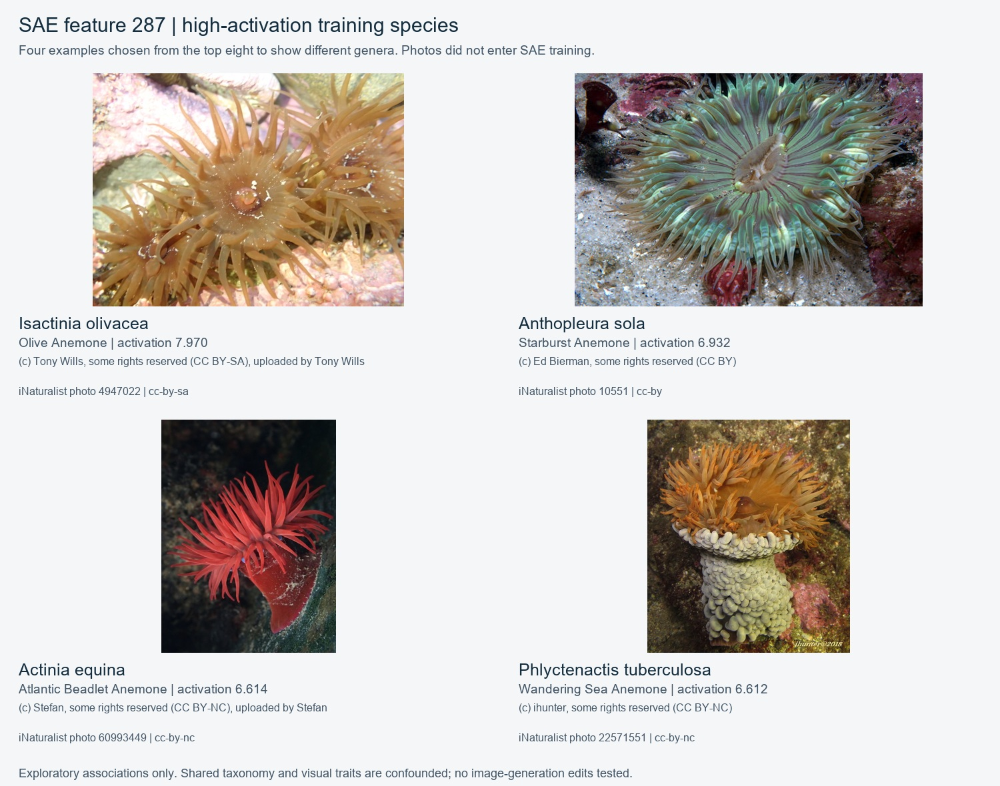

# SAE pilot: 5,388 animal species

The expanded embedding dataset, small SAE, held-out evaluation and five candidate-feature photo panels are complete. This is an exploratory analysis of **BioCLIP 2 taxonomy embeddings**. It does not yet establish biological trait controls or include generated images.

## What was completed

- Extracted **5,388 × 768** raw float32 taxonomy embeddings with the official pretrained BioCLIP 2 checkpoint.
- Used all 5,388 Animalia entries in the official TreeOfLife-10M iNat21 naming metadata: **27 classes, 715 families and 2,988 genera**.
- Trained a **768 → 2,048 → 768 TopK SAE**, with **32 nonzero features per species**.
- Held out entire genera for validation and testing; no genus appears in more than one split.
- Selected five exploratory features from training-only activation lists and inspected four attributed real photos per feature.

## Evaluation

| Split | Species | Genera | Reconstructed variation | Mean reconstruction cosine |
|---|---:|---:|---:|---:|
| Train | 4,254 | 2,382 | 83.44% | 0.9580 |
| Validation | 541 | 303 | 56.36% | 0.8871 |
| Test | 593 | 303 | 56.31% | 0.8874 |

**Interpretation:** the SAE reconstructs 83.44% of training variation but only 56.31% for held-out test genera. This is a substantial generalization gap. Treat it as a working exploratory model; reconstruction fidelity needs improvement before interpreting image changes as precise trait interventions.

“Reconstructed variation” is 1 − (squared reconstruction error / squared distance to the training mean). It is not classification accuracy. The test cosine fifth percentile is 0.8404.

Training stopped after 55 epochs; the best validation checkpoint was epoch 15. Neither test scores nor photo appearance selected that checkpoint. All 2,048 dictionary features activate somewhere in training (zero globally dead training features). Exactly 32 active coordinates is imposed by TopK, not a discovered property of biology.

### Reconstruction references

| Representation | Test reconstructed variation | Test mean cosine |
|---|---:|---:|
| PCA, 32 dense components | 50.46% | 0.8701 |
| SAE, 32 active of 2,048 | 56.31% | 0.8874 |
| PCA, 128 dense components | 76.96% | 0.9416 |

PCA was fitted only on training vectors. These references show the reconstruction/sparsity trade-off; they are not parameter-matched interpretability comparisons. The SAE modestly outperforms PCA-32 here, while PCA-128 retains substantially more information. Better reconstruction alone would not establish interpretable traits.

## Five candidate features

**These labels are human hypotheses after photo inspection, not model-provided names or confirmed causal traits.** Many highly activating species share taxonomy words. Each feature may represent an entire animal group or multiple correlated attributes. Feature numbers are zero-based and specific to this checkpoint.

| Feature | Candidate visual association | Active training species | Active test species |
|---|---|---:|---:|
| 192 | Owl-like face and frontal eyes | 36 | 6 |
| 190 | Long pointed bill in kingfishers | 45 | 6 |
| 208 | Rounded, domed ladybird body | 68 | 5 |
| 598 | Squirrel-like fur and bushy tail | 77 | 15 |
| 287 | Radial tentacles in sea anemones | 65 | 16 |

An activation is counted when greater than 1e-7. Support counts include low activations; they do not mean every active species exhibits the proposed trait. Test counts are descriptive, not a held-out validation of the human labels.

### Feature 192: Owl-like face and frontal eyes

**Observed in photos:** The four inspected owl photos show prominent forward-facing eyes, broad heads and relatively short central bills. Plumage and ear tufts differ; ear tufts are not shared by all four.

**Candidate interpretation:** This feature may associate with owl head/face structure.

**Competing explanation:** It may primarily encode the family Strigidae or the complete owl appearance, rather than an independently controllable face trait.

**Future generation test:** Hold species, prompt and seed fixed; change feature 192 and check face/eye structure while measuring unintended changes in plumage, body and background. Include non-owl controls.

Top eight training species by activation:

| Scientific name | Source common name | Activation | Family |
|---|---|---:|---|
| *Bubo scandiacus* | Snowy Owl | 8.1266 | Strigidae |
| *Asio otus* | Long-eared Owl | 7.4966 | Strigidae |
| *Surnia ulula* | Northern Hawk Owl | 7.1343 | Strigidae |
| *Asio flammeus* | Short-eared Owl | 7.0118 | Strigidae |
| *Bubo bubo* | Eurasian Eagle-Owl | 6.5846 | Strigidae |
| *Ninox novaeseelandiae* | Morepork | 6.5478 | Strigidae |
| *Bubo virginianus* | Great Horned Owl | 6.4975 | Strigidae |
| *Megascops asio* | Eastern Screech-Owl | 5.9577 | Strigidae |

The panel favors different genera among these eight; it is not necessarily the top four by score. One image per species does not cover sex, life stage, seasonal plumage or other variation.

### Feature 190: Long pointed bill in kingfishers

**Observed in photos:** All four kingfisher photos show an elongated pointed bill, despite substantial differences in color and markings. The Pied Kingfisher's bill is open, so pose differs.

**Candidate interpretation:** This feature may associate with the elongated bill and head proportions typical of kingfishers.

**Competing explanation:** All top-eight training examples are Alcedinidae; family wording and overall kingfisher identity are confounded with bill shape.

**Future generation test:** Measure bill length relative to head size under small feature edits across several species and seeds; check whether the entire animal changes into a kingfisher.

Top eight training species by activation:

| Scientific name | Source common name | Activation | Family |
|---|---|---:|---|
| *Chloroceryle amazona* | Amazon Kingfisher | 8.0712 | Alcedinidae |
| *Megaceryle torquata* | Ringed Kingfisher | 7.1678 | Alcedinidae |
| *Megaceryle alcyon* | Belted Kingfisher | 7.1147 | Alcedinidae |
| *Megaceryle maxima* | Giant Kingfisher | 6.9440 | Alcedinidae |
| *Chloroceryle americana* | Green Kingfisher | 6.5088 | Alcedinidae |
| *Ceryle rudis* | Pied Kingfisher | 6.0340 | Alcedinidae |
| *Halcyon senegalensis* | Woodland Kingfisher | 4.7113 | Alcedinidae |
| *Alcedo atthis* | Common Kingfisher | 4.3951 | Alcedinidae |

The panel favors different genera among these eight; it is not necessarily the top four by score. One image per species does not cover sex, life stage, seasonal plumage or other variation.

### Feature 208: Rounded, domed ladybird body

**Observed in photos:** The four ladybird references show compact oval or rounded bodies and curved wing covers. Color and spots vary; the spotless example rules out treating this simply as a spots feature.

**Candidate interpretation:** This feature may associate with rounded body/wing-cover shape.

**Competing explanation:** It may encode Coccinellidae identity or beetle appearance broadly. One small reference shows limited detail, and there are no controlled shape measurements.

**Future generation test:** Vary feature 208 while tracking body outline and wing-cover curvature; use spotted and spotless examples and inspect unwanted color changes.

Top eight training species by activation:

| Scientific name | Source common name | Activation | Family |
|---|---|---:|---|
| *Cycloneda polita* | Western Spotless Lady Beetle | 8.9097 | Coccinellidae |
| *Cycloneda munda* | Polished Lady Beetle | 7.9402 | Coccinellidae |
| *Cycloneda sanguinea* | Spotless Ladybird | 7.9120 | Coccinellidae |
| *Coccinella californica* | California Lady Beetle | 7.4099 | Coccinellidae |
| *Psyllobora vigintimaculata* | 20-spotted Ladybird Beetle | 6.9074 | Coccinellidae |
| *Coccinella undecimpunctata* | Eleven-spotted Ladybird Beetle | 6.7950 | Coccinellidae |
| *Cheilomenes sexmaculata* | Six-spotted Zigzag Ladybird Beetle | 6.7084 | Coccinellidae |
| *Coccinella septempunctata* | Seven-spotted Ladybird Beetle | 6.5890 | Coccinellidae |

The panel favors different genera among these eight; it is not necessarily the top four by score. One image per species does not cover sex, life stage, seasonal plumage or other variation.

### Feature 598: Squirrel-like fur and bushy tail

**Observed in photos:** All four squirrel photos show fur and small rounded or pointed ears; several clearly show a bushy tail, while the tail is only partly visible in the Pallas's squirrel view. Ear tufts and body markings vary.

**Candidate interpretation:** This feature may associate with squirrel-like body and tail appearance.

**Competing explanation:** It may encode Sciuridae identity; the selected photos cannot isolate tail bushiness from the rest of the animal.

**Future generation test:** Use full-body generations with visible tails; measure whether tail fullness changes without changing species, pose, fur color or body size.

Top eight training species by activation:

| Scientific name | Source common name | Activation | Family |
|---|---|---:|---|
| *Callosciurus erythraeus* | Pallas's Squirrel | 7.2469 | Sciuridae |
| *Sciurus vulgaris* | Eurasian Red Squirrel | 6.6091 | Sciuridae |
| *Sciurus granatensis* | Red-tailed Squirrel | 6.5622 | Sciuridae |
| *Tamiasciurus douglasii* | Douglas' Squirrel | 6.4003 | Sciuridae |
| *Sciurus aureogaster* | Red-bellied Squirrel | 6.3437 | Sciuridae |
| *Callosciurus notatus* | Kloss squirrel | 6.2356 | Sciuridae |
| *Geosciurus inauris* | South African Ground Squirrel | 6.1814 | Sciuridae |
| *Sciurus variegatoides* | Variegated Squirrel | 5.9704 | Sciuridae |

The panel favors different genera among these eight; it is not necessarily the top four by score. One image per species does not cover sex, life stage, seasonal plumage or other variation.

### Feature 287: Radial tentacles in sea anemones

**Observed in photos:** The four anemone photographs show tentacles arranged around a central disc. Their colors, tentacle proportions and body surfaces differ substantially.

**Candidate interpretation:** This feature may associate with radial tentacle organization.

**Competing explanation:** It may encode sea-anemone taxonomy or the whole body plan. All four displayed photos are Actiniidae, although the top-eight list also includes Sagartiidae.

**Future generation test:** Vary feature 287 while inspecting tentacle arrangement and count across different anemones; check whether it instead changes the whole organism or scene.

Top eight training species by activation:

| Scientific name | Source common name | Activation | Family |
|---|---|---:|---|
| *Isactinia olivacea* | Olive Anemone | 7.9696 | Actiniidae |
| *Anthopleura sola* | Starburst Anemone | 6.9319 | Actiniidae |
| *Actinia equina* | Atlantic Beadlet Anemone | 6.6140 | Actiniidae |
| *Phlyctenactis tuberculosa* | Wandering Sea Anemone | 6.6120 | Actiniidae |
| *Anthothoe albocincta* | White-striped Anemone | 6.3498 | Sagartiidae |
| *Anthopleura elegantissima* | clonal anemone | 6.2594 | Actiniidae |
| *Actinia tenebrosa* | Waratah Anemone | 6.1391 | Actiniidae |
| *Urticina grebelnyi* | Painted Anemone | 6.0512 | Actiniidae |

The panel favors different genera among these eight; it is not necessarily the top four by score. One image per species does not cover sex, life stage, seasonal plumage or other variation.

## Method and limitations

Taxonomy strings use the same pilot format: `Kingdom, Phylum, Class, Order, Family, Genus, specific epithet`. Common names and photographs are excluded from embedding extraction. Names are preserved from the official training metadata and may differ from modern taxonomy or common-name conventions.

The SAE subtracts the training mean and divides by one global training RMS; this transformation is inverted when reconstructing the 768-dimensional output. Encoder: linear layer, ReLU, retain largest 32 activations. Decoder: linear dictionary with unit-length columns and a learned output bias. Training: Adam, learning rate 0.001, batch 256, seed 20260929, gradient clipping 1.0. Validation error is checked every five epochs; the best checkpoint is saved.

The split groups complete genera and is stratified by taxonomic class. Classes containing fewer than three genera remain training-only. Class representation is imbalanced: insects and birds dominate. All species may already have been seen during BioCLIP pretraining; “held out” here refers only to SAE training.

Feature selection was manual and exploratory, based on recognizability of training top-activation lists. No feature-selection accuracy, trait annotations, null controls, multi-seed stability or causal specificity were measured. Photos illustrate candidate interpretations rather than prove them. A feature can be a taxonomy/word feature, a whole-animal identity feature, or a mixture of visual traits.

## Remaining dependency: TaxaAdapter

This animal subset comes from the public TreeOfLife-10M iNat21 metadata. **It is not confirmed to be the exact TreeOfLife-1M TaxaAdapter species list.** Exact generator input formatting, embedding normalization and adapter compatibility remain unverified.

The public [TaxaAdapter repository](https://github.com/Imageomics/TaxaAdapter) was checked directly at 2026-09-29T12:01:43.091316+00:00. Its root contained only `.gitignore`, `LICENSE` and `README.md`. No runnable generator/checkpoint was present there. We did not contact Professor Chao or send messages.

To run the causal phase, obtain the TreeOfLife-1M checkpoint, inference code, exact taxonomy list and extraction/normalization settings from the authors. Confirm whether the assignment means 200+ or 200K+ species. Then first compare original embeddings against unedited SAE reconstructions under fixed seeds; only after that compare feature removal/increase. A prepared request is in `../MODEL_FILES_REQUEST.md`.

## Saved artifacts

- `../data/embeddings_raw.npy`: 5,388 × 768 float32 input embeddings.
- `../data/embeddings_normalized.npy`: unit-length copies; the SAE was trained on the raw vectors with its own recorded centering/scaling.
- `../data/species.csv`: exact taxonomy, source IDs and split for every row.
- `sae.pt`: reloadable SAE weights, preprocessing buffers and configuration.
- `sparse_vectors.npy`: 5,388 × 2,048 sparse vectors (stored as a dense NumPy array).
- `reconstructed_embeddings.npy`: 5,388 × 768 reconstructed vectors.
- `feature_catalog.csv`: 20 real examples across five candidate features, with observations and source links.
- `features.json`: support counts and top eight training examples for all 2,048 features.
- `selected_features.json`, `feature_*.jpg`, `photo_credits.md`: inspected examples and attribution.
- `evaluation.json`, `training_history.csv`, `verification.json`, `run_manifest.json`: measurements, checks and provenance.

## Validation performed

Verified dimensions, finiteness, exact TopK sparsity, source/embedding hashes and absence of genus overlap. Reloaded the checkpoint on CPU and reproduced saved GPU reconstructions/codes within floating-point tolerance. Independently recomputed all split reconstruction metrics in NumPy float64. Verified the mathematical effect of a one-feature edit on the decoder output. Opened all reference photos and visually inspected all five assembled panels. No TaxaAdapter runtime or image-generation test has occurred.

## Sources

- [Pinned official TreeOfLife-10M iNat21 naming metadata](https://huggingface.co/datasets/imageomics/TreeOfLife-10M/resolve/91debffb7146c32c89d76feb1eb575b555e2ecc7/metadata/naming/inat21_name_lookup.json)
- [Official BioCLIP 2 model](https://huggingface.co/imageomics/bioclip-2)
- [TaxaAdapter paper](https://arxiv.org/abs/2603.26128)
- [SAE interpretation and intervention reference](https://arxiv.org/abs/2502.06755)
- [All photo credits and links](photo_credits.md)
